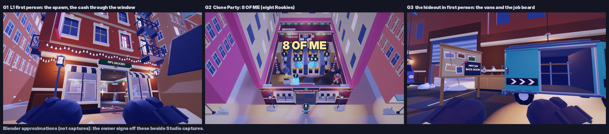

# Golden frames: the target image (PLAN_STEAM_PLUS §3.3; re-specced 2026-11-13 for first person and the Rookie)

Three frames are built to final quality in the engine, captured on the owner's phone and in Studio, and **signed off by the owner** (target: Wed Nov 18). After sign-off they are the style reference: every later shot is graded side by side against the matching frame (PLAN §8.2). No multi-level art work goes past them before the sign-off.

The one-sentence look (PLAN §3.1): **"A Christmas Eve caper in a toy-sized town, and the whole crew is you."**

**Why the re-spec (REVIEW_STEAM_PLUS gap #4).** The first set targeted the old game: G1 was the overhead diorama spawn, G2 had blank pre-Rookie clones, G3 a 3/4 diorama of one van bay. First person is now the default camera (PLAN_FIRST_PERSON), every copy of you is a Rookie, and the hideout is walked in first person. A Nov 18 sign-off on the old set would approve the wrong target, so all three frames are re-specced and re-shot below. The old renders stay in `docs/audit/levels/golden/` for history.

Each frame lists its composition, what must be in it, and the pass checks. Scene staging for capture uses a Studio-only attribute, `EH_Scenario` (PLAN §8.1 R3 step 3), never a new remote. The Blender approximations of all three are in **`docs/audit/levels/golden_fp/`** (`python3 tools/blender/level_shots.py --golden-fp`, one process per frame; `--only G1|G2|G3`; graded by `frame_grade.py` into `grades.json`; `contact_sheet.png`). They are what the owner signs off **beside the Studio captures**: the tone-map proxy is uncalibrated (REVIEW #1), so a render is a target for composition and light, not for exact values.

**Clipping check (every frame, LIGHT AND SPRINT track, 2026-11-13).** Besides near-black ≤ 5 %, a frame passes only with **clipped / near-white ≤ 3 %** (luma ≥ 0.94 after bloom: `frame_grade.py` reports `clipped` and `clipped_ok`). Only lamp bulbs, Neon and the signals may clip; a lit wall, a door frame or a shelf washed to white fails. Why: the owner's live v125 screenshot of L1's back room in first person graded **27.7 % clipped** (30 % glow share, median luma 0.61) while every Blender approximation here graded 0-0.03 %: the Blender proxy (exposure 0.3, `LAMP_W` calibrated by eye, no stacked Future lights) does not see what the engine does, so **the Studio / phone capture is the frame that is graded for clipping**, never the render alone. The numbers that caused it and the bounds that now hold them are in `Config.Lighting.LIMITS` (`tests/unit/HeistLighting.spec.luau`).

---

## G1: L1 "Back Room" in first person, on the street in front of the shop

**Camera:** first person (the default), eye height **3.8** (the Rookie's eyes), FOV 70 (the comfort default). Spawn 1 stands 3.5 studs from the shop's door, so from the spawn itself the doorway fills the eyes and nothing above the awning shows. The staging therefore walks you back past the van onto the street (`GOLDEN.G1.STAND` = (-10, 28), level space: beside the van's left, 14 studs behind spawn 1), turns you toward the cash on its safe in the back room (`LOOT = "Cash"`, the yaw the line of sight takes through the open door and the partition window), and tilts you up **18°** (`PITCH = -18`), so the frame's top looks 53° up the facade.

**In frame:**
- **Your Rookie hands** (the knit gloves of the default outfit) low in both corners, the **reticle** at the centre. The HUD (loop clock, loot bar, REWIND) is 2D on top in the game; the render draws only the reticle.
- The shop front: **Pip's Grocery** sign board with its wreath, the **striped awnings**, the warm windows, the open door onto the lit shop (rug, ceiling lamps, the back door with plate A's letter).
- **The cash glinting** through the door and the right partition window (the loot glint, every 2 s). Only its top clears the partition sill from the street (`HeistL1Cash`): the glint is what reads.
- The **tall tenement** above: the warm string lights over the shop front, three storeys of lit windows, the fire escape, the hanging blade sign; the neighbouring tenements left and right.
- **Snow** falling, on the sills and the kerb; the two street lamps; a strip of **aurora** in the sky at the top right (Heist/Aurora).
- The van at the right edge, dim, in shadow. It must not be the brightest thing.

**Composition:** the door and the cash glint on the centre line, the sign board just above the reticle, the hands framing the bottom third. The brightest non-signal things are the string lights and the cash glint.

**Pass checks:**
- **Grading (§8.2):** near-black ≤ 5 %, warm share ≥ 30 %, value spread (p90-p10) ≥ 0.45.
- **Readability:** the cash glint and the sign board read at 48 px on a 360-dp phone.
- **Hands:** in both corners, never over the door or the glint (they sit lower and smaller in the game if they cover it: Config.FirstPerson.VIEWMODEL.REST).
- **Owner:** "would I stop scrolling on this?"

**Render (`golden_fp/G1_fp_spawn.png`):** near-black 0.14 %, dark 7.8 %, median luma 0.30, value spread 0.54, RMS 0.21, warm 45.7 %, signal pop +0.42 (plate A's ring through the door). **Score 7/10:** the shop front, the tenement, the string lights, the snow and the cash glint all read in one first-person frame; the hands are blocky stand-ins posed by hand (the kit gloves at REST, not the Viewmodel's exact grip rotation) and a touch big; the aurora is a sliver; the van fills the right sixth.

## G2: L5 Clone Party at "8 OF ME", eight Rookies

**Camera:** the 8 OF ME moment's pull-back (MomentDirector, `Config.Moments.SWARM`; staged `GOLDEN.G2`): pitch 45°, FOV 45, yaw 0, the distance fitted so **you and every clone sit inside the central 32 %** of the frame width (9:16-safe, criterion H3) and 80 % of the half height. The cut-away opens the Toy Shop's roof, ceiling and front.

**In frame:**
- The Toy Shop (Hoardsworth's Toys) interior: berry-plum walls, **candy pink and gold** light, the giant candy canes and **the giant toy soldier** (the signature silhouette), gold loot on the gondolas.
- **Eight copies of you, every one a Rookie** (the CharacterKit body in your outfit: flat cap, long scarf, Breton stripes, knit gloves):
  - the seven clones drawn as EchoView draws your solo runs: the outfit kept, only the crew pieces (scarf, stripes) in your crew colour, older runs dimmer and drifting toward violet;
  - the crew-colour Highlight (fill 0.55 + outline), a floor glow and a **numbered pill** each (1 = your oldest run, 8 = you);
  - you (8) on the street at the spawn, in your own colours.
- **Gus** on his patrol with his torch cone.
- The **8 OF ME** stamp in the display face above the crew, covering no face.
- The world dimmed **15 %** (the clones not).

**Composition:** the eight Rookies are the most saturated things in frame. The stamp sits above them.

**Pass checks:**
- **Recognisability:** 4 of 5 testers pick out *their own* clone in a 64 px crop (PLAN §3.1).
- **Thumbnail:** the 64 px thumbnail answers "which ones are past me?" in ≤ 0.5 s (premium A2).
- **Clone pop:** the clones' value over their surround ≥ 0.15 (premium A1).
- **Sound-off:** a sound-off 1-second clip of it is recognisably ours (premium I1).

**Render (`golden_fp/G2_eight_of_me.png`):** the seven staging tapes sampled 3 s into the run (seven distinct spots in the aisles, walking back toward the camera; at 5 s the placeholder solution's symmetric pairs overlap), the fit distance 67 studs; near-black 0 %, median luma 0.40, value spread 0.44, warm 24 %, **clone pop +0.26**, pink cast 0.09. **Score 6.5/10:** eight Rookies in crew colours with their pills and the stamp, the toy soldier, the candy canes; but at the central-32 % fit the Rookies are small (about 40 px tall at 720p) and the two outer clones stand half behind the gondola ends. The real solution recording (the owner's, MASTERPLAN §8.9) will bunch them differently; reshoot then.

## G3: the warehouse hideout in first person, at the vans with the job board

**Camera:** first person, eye 3.8, FOV 70. The staging moves you to `GOLDEN.G3.STAND` = (22, -10) in the aisle (in front of the job board, your van beside it) and turns you toward `LOOK_AT` = (19, 4.2, -21), 4° up.

**In frame:**
- **Your Rookie hands** low in the corners, the reticle.
- **The job board** (cork, pinned photos, the red string) with the **NEXT JOB** card glowing ("BACK ROOM" on a new account): the focal point, about 12 studs away, 25° off its face.
- **Your van** in bay 1 in your crew's paint, its side door open onto the cargo seats, the bay's arrows.
- The trophy shelf behind the board, the roll-up door half open onto the snowy yard, a neighbouring van dimmer at the left, a work lamp's pool on the floor.

**Composition:** the board left of centre and the van right of it share the light; the NEXT card is the brightest text in frame.

**Pass checks:**
- the grading (near-black ≤ 5 %, warm share ≥ 25 %);
- the NEXT card reads at 48 px on the phone;
- no default Roblox grey or white blocks anywhere.

**Render (`golden_fp/G3_fp_hideout.png`):** near-black 0.12 %, dark 5.6 %, median luma 0.21, value spread 0.50, warm 37.4 %. **Score 7/10:** a clear "this is my hideout and my next job" frame; the van is close and fills the right half, the upper third is plain warehouse wall and windows, and the LOBBY track's van plates, seat cards and station dressing are not drawn in the render (the game has them).

---

## Typography specimen (decision D8)

One Studio frame shows the wordmark "HEIST YOURSELF" (chunky rounded capitals with a cyan double-exposure offset), with **Luckiest Guy** and **Fredoka One** at 14, 24, 36 and 64 px. Each is shown on the stamp, a button label and a results line, on top of a G1 background. The owner picks one. Builder Sans stays the UI face.

## Clone recognisability A/B (PLAN §3.1)

The same G2 frame is shot twice:
- **(a)** the textured Rookie under the crew-colour fill (0.55);
- **(b)** a stripped hologram (no textures).

Shown to testers as 64 px crops with 4 avatars each.

## Capture

The owner takes each frame on their phone and in Studio (Quality 10 and Automatic), and drops the shots in the **Shots inbox** (GitHub issue #1). Claude grades them and puts them side by side with the Blender previews in `docs/audit/levels/golden_fp/`, which are calibrated once against the Studio shots.

### Staging a frame in Studio (`EH_Scenario`)

1. In Studio, select **Workspace** in the Explorer. In Properties > Attributes, add a **string** attribute named `EH_Scenario` with one of the values below.
2. Press **Play**. The server stages the scene for the first player; the camera goes to the frame's framing and the Studio debug chip hides itself.
3. Take the shot. To return to normal play, delete the attribute (or clear its value) before the next Play.

| Value | What you get |
|---|---|
| `G1` | L1 "Back Room" starts at once in **first person**. Once the run-start beat has eased into your eyes, you are moved to `GOLDEN.G1.STAND` on the street and turned toward the cash (tilted up 18°); once per run, so a REWIND restages it. Don't touch the mouse or the stick until the shot is taken. |
| `G2` | L5 Clone Party starts with **7 clones** from the level's solution recordings in your deck, so run 1 is you + 7 = **8 OF ME**, all Rookies (the stamp fires after the tape print). The camera is the pull-back: pitch 45°, FOV 45, the distance fitted so you and every clone sit inside the central 32 % of the width. |
| `G3` | The hideout (no heist starts), in **first person**: you are moved once to `GOLDEN.G3.STAND` in front of the job board and turned toward it and your van. |
| `TYPE` | `G1` plus the type specimen overlay: the wordmark, Luckiest Guy and Fredoka One at 14 / 24 / 36 / 64 px. |
| `CLONE_AB` | `G2`. Add a string attribute `EH_Variant` = `B` for the stripped arm (clone templates without textures or clothing); `A` or no attribute is the textured arm. |

It is **Studio only**: the server and the client read the attribute only through `Scenario.resolve(RunService:IsStudio(), ...)`, so a live server ignores it (`tests/unit/HeistScenario.spec.luau` checks the gate and scans the sources, and checks the G1 / G3 looks keep the cash, the NEXT card and your van in a 16:9 frame). Code: `src/shared/Heist/Scenario.luau` (`lookAt`, `fpLook`: pure), `src/server/Heist/Staging.luau`, `src/client/Heist/GoldenShots.luau` (the first-person look goes through `CameraDirector.frameRunStart`, so the camera director's own first-person code draws the frame: hands, bob, body hiding); numbers in `Config.Heist.CAMERA.GOLDEN`. The G2 clones are `src/server/Heist/StagingTapes.luau`, generated by `lune run tools/staging_tapes.luau` from `tests/sim/Solutions.cs5_clone_party` (the scripted PLACEHOLDER until the owner records the real solution; rerun the tool when the level or the solution changes, `tests/sim/StagingTapes.spec.luau` fails until you do; unchanged by this re-spec: `--check` says up to date). The renders read the same looks and tapes through `tools/blender/golden_plan.luau`.
