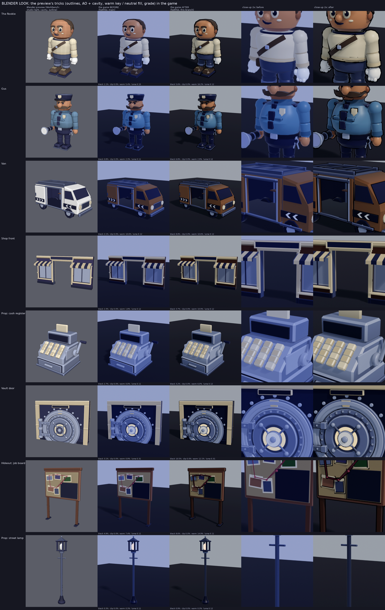
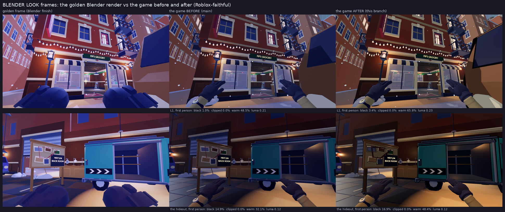

# Blender look: the preview's tricks, in the game

_2026-11-14, branch `blender-look`. Owner (after the studio-fidelity audit said the Blender previews used studio light, black outlines, ambient occlusion and bloom the game does not have): "So fix it so we use the same tricks as in Blender, so everything looks perfect."_

**Short answer.** Three of the four tricks are now real game data, and the fourth is a lighting change:

| Blender trick | In the game now | Cost |
|---|---|---|
| Black object outline (Workbench) | **Inverted-hull outlines** baked into the kit (`<Piece>_Outline`, 88 hulls), welded onto every character, hero prop and loot piece by KitService; a per-tier budget picks the nearest few (client `Heist/Outlines`) | triangles only: worst case per tier in the table below, all tiers inside their budget |
| Cavity + ambient occlusion | **Baked into vertex colours** (greyscale, deterministic ray-cast AO + crease cavity) on every small and medium kit piece | 0 triangles, 0 texture memory, 0 draw calls |
| Studio key / fill light | **Recipe A and C relit**: a warm key, a neutral cool-not-violet fill, no cool tint in the grade | none |
| Bloom / filmic grade | Kept subtle (Bloom 0.25 / 16 / 1.6), Roblox's Default tonemapper (`ColorGradingEffect`), ColorCorrection Contrast / Saturation 0.1, a slightly warm tint | none |

`tools/blender/look_sheet.py --before <main's assets/fbx + default.project.json>` (the same 8 assets as the studio-fidelity sheet). Columns: the Blender preview the owner liked, the game **before** (Roblox-faithful `roblox_look.py`, main's FBX and Lighting), the game **after** (this branch's FBX with the AO, the hulls, this branch's Lighting), 2x close-ups. Graded with `frame_grade.py` (numbers under each tile, `blender_look/assets.json`):

| Asset | near-black % before -> after | clipped % | warm share % before -> after |
|---|---|---|---|
| The Rookie | 1.1 -> 5.6 | 0 -> 0 | 5.4 -> 16.2 |
| Gus | 0.8 -> 6.8 | 0 -> 0 | 2.3 -> 2.9 |
| Van | 2.1 -> 8.8 | 0 -> 0 | 10.6 -> 10.6 |
| Shop front | 2.3 -> 3.7 | 0 -> 0 | 1.8 -> 10.9 |
| Cash register | 2.7 -> 3.2 | 0 -> 0 | 0.0 -> 6.0 |
| Vault door | 3.1 -> 10.5 | 0 -> 0 | 0.9 -> 12.1 |
| Job board | 4.9 -> 8.6 | 0 -> 0 | 7.4 -> 14.9 |
| Street lamp | 0.3 -> 0.9 | 0 -> 0 | 0.3 -> 0.3 |

The near-black rise is the ink line itself (and the AO in creases); the warm share rise is the cast gone (the cream sweater, the gold, the brass and the wood read as themselves, not lavender). Nothing clips.

## 1. Outlines (inverted hulls)

**How it works.** `assets/blender/zz_outlines.py` rebuilds the source specs and, for each chosen piece, makes a hull with `tools/blender/eh_look.make_hull`: a copy of the mesh, welded, decimated (an outline needs the silhouette, not the detail), pushed out along its vertex normals with even thickness at corners, faces reversed, every UV on the ink cell. Same origin as its piece. Roblox culls back faces (`MeshPart.DoubleSided` stays false), so only the part of the hull outside the piece's silhouette draws: a dark rim, like the Workbench outline, and it also draws the inner lines where one piece overlaps another (an arm in front of the torso), which a Highlight cannot.

**Why not Highlights.** A `Highlight` draws a constant-width screen outline of a whole model, but only its outer silhouette (no line between the arm and the torso), its first instance costs up to 1 ms of GPU on mobile and its cost grows with screen coverage there (vault: Highlights and Selection Effects). The Highlight budget (Config.Perf `highlights` 10 / 10 / 5 / 2) is already spent on the clones' crew outlines; the slot limit is 255 since October 2026 (the old 31 is gone), but the per-tier budget is the real limit. **The Highlight count is unchanged** (perf_engine: 5 / 5 / 5 / 2 in the busiest view).

**Which pieces** (thickness in studs; 0.035 studs is about 1 px at 27 studs on a 1080p screen):

| Group | Pieces | Thickness | Decimation |
|---|---|---|---|
| `Rookie_Outline` (priority phase) | the 15 body pieces; caps, scarves (and the long scarf's tails), gloves, the eye mask. Not the faces; not the flush stripes, cuffs and blocks (the body's hull draws their outline) | 0.035 (outfit 0.03) | 0.7 |
| `Gus_Outline` | 17 pieces (not the lens) | 0.035 | 0.7 |
| `Hoardsworth_Outline` (intro phase) | 16 pieces (not the monocle) | 0.035 | 0.7 |
| `Van_Outline` (intro phase) | Van, Van_Paint | 0.06 | 0.6 |
| `Prop_Outline` | the three hideout vans, the vault door (door, frame, dial), the job board, the plate, the door leaf, the giant present (hero); cash bag, present, candy, toy, teddy, gold bar and stack, diamond, register drawer (loot) | 0.045-0.06 hero, 0.03-0.035 loot | 0.6-0.8 |
| level geometry | none: walls, floors and facades would double the level's ~100k triangles; the AO bake and the lighting carry them | | |

Decimation: at 0.35 (first try) the collapsed hull cut across concave spots in front of the body and drew black patches inside the silhouette (seen in the faithful preview on Gus's chest); 0.7 draws a clean line (sheet above).

**In the engine.** KitService prepares a hull as visual-only (`Anchored` false, `Massless`, `CanCollide` / `CanQuery` / `CanTouch` / `CastShadow` off, Neon in `Config.Outline.COLOUR`, no texture, the upload's Default collision: no `CreateMeshPartAsync` rebuild at boot) and welds it to its piece (child + `Weld`, tag `EH_Outline`). Every clone of the piece carries it: player characters and outfits (Rookie.assemble / apply), the clone templates and the clones, the Line-up, Gus, the intro cast, the vans, the level props and loot. A placed piece that is resized (KitPlan's per-axis scale) resizes its hull with the same margin. Loops that anchor or restyle every descendant skip hulls (GusTemplate, IntroKit, Avatars' clone stripping, WorldView's vault-door skin); `Rigs.partsOf` skips them, so the clone fades, tape print and LOD never write a hull.

**Client policy (`Heist/Outlines`, pure `Shared/Heist/OutlinePlan`).** Every 0.25 s, per class, the tier's nearest units inside the radius draw; a unit is a character model (all its hulls) or one hero / loot piece; a hidden unit never takes a slot; your own character comes after everyone else (it already wears its rim Highlight). A drawn hull mirrors its piece's Transparency and LocalTransparencyModifier at once (property signals), so it fades with a clone, vanishes with the clone LOD swap, in first person, behind a cut-away wall and with picked-up loot.

| `Config.Outline.TIERS` | characters | loot | hero props | radius |
|---|---|---|---|---|
| 1 quality | 16 | 8 | 14 | 60 |
| 2 balanced | 2 | 1 | 0 | 40 |
| 3 performance | 1 | 1 | 0 | 30 |
| 4 minimum | 1 | 1 | 0 | 24 |

**First-person hands.** The skinned gloves (`Rookie_FPHands_R` / `_L`) carry their ink hull **inside the same mesh** (`fp_hands.py add_outline`): every face duplicated with the same bone weights, pushed out 0.0016 studs (the in-game size), reversed and vertex-coloured ink, so `MeshPart.Color` (the glove colour) times ink stays near black. A separate hull MeshPart was not possible: a skinned hull needs the same Bones, and the importer moves every Bone under a generated RootPart when a file holds two meshes (measured on fp-hands-v2). Cost: +2,600 triangles a glove (`ARMS.TRI_BUDGET_V2` 5,600 -> 8,400). The rigid forearm pieces (cuffs, sleeve) have no hull: they leave the screen through its lower corners.

## 2. Ambient occlusion and cavity

**Do vertex colours render?** What is proven: the importer keeps them (fp-hands-v2's glove: EditableMesh `GetColors` reads its shading back; kit_engine B3 reads the baked AO back on 5 sample pieces). What the engine does with them is documented by Roblox (the 3D Importer reads FBX vertex colours and offers "Ignore Vertex Colors") and recorded by the vault (multiplied into the surface colour). No headless engine call renders a frame, and `thumbnails.roblox.com` is outside this session's network, so the visible multiply is **not measured here**: it is the one item for the owner to confirm in Studio (§6). If it ever shows nothing, nothing breaks (white = no change).

**The bake** (`tools/blender/eh_look.bake_ao`, called by `build_asset.py` for every asset): per vertex, 40 fixed cosine-weighted hemisphere rays against the piece (or the whole rig for assembled assets: the Rookie, Gus, the vans, the vault door...) and a floor plane for floor-standing assets; contact occlusion within 1.1 studs (strength 0.42) plus crease occlusion within 0.22 (strength 0.22), floor 0.6, stored as a linear greyscale POINT colour (`EH_AO`) and exported sRGB. Deterministic (no render noise), so a rebuild keeps the content hash and the uploaded id. Only SmoothPlastic pieces up to 16 studs: walls, floors, facades and skylines have too few vertices to carry it (the vault's "triangle streaks" warning); Neon, glass, hero SurfaceAppearances and the already-shaded gloves are skipped.

Not done: per-asset AO textures (the atlas is a shared palette, and the vertex bake costs nothing), blob shadows under characters (the clones already draw a floor glow; Future lighting's sun and the hero SpotLight cast real shadows), contact strips in wall seams (walls are 8-vertex boxes: a strip needs new edge loops on every wall piece).

## 3. Lighting: the blue-violet cast

| Recipe A (the four project files) | Before | After | Why |
|---|---|---|---|
| ColorShift_Top (the key's tint) | 150, 175, 255 | **255, 240, 222** | the Blender key was warm-white; the blue key turned every lit face lavender |
| ColorShift_Bottom | 40, 30, 70 | **36, 40, 52** | violet bounce -> neutral cool |
| Ambient (indoor fill) | 118, 122, 152 | **128, 130, 138** | the violet fill made warm skin and leather purple-brown in shadow |
| OutdoorAmbient | 160, 170, 204 | **160, 168, 182** | cool, not violet |
| Brightness | 1.6 | **1.9** | the warm key is less saturated than the blue one: same lit level |
| EnvironmentDiffuseScale / SpecularScale | 0.36 / 0.25 | **0.22 / 0.2** | the night skybox is deep blue: less of it in the fill and the highlights |
| ShadowSoftness | 0.3 | **0.22** | crisper contact shadows (the Blender sun) |
| Atmosphere Color / Decay | 148,160,208 / 112,122,178 | **152,164,192 / 112,124,156** | the haze less violet |
| ColorCorrection Contrast / Saturation / Tint | 0.08 / 0.08 / 238,242,255 | **0.1 / 0.1 / 255,250,242** | the grade no longer adds the cool cast; contrast inside LIMITS (<= 0.12) |
| Bloom, ExposureCompensation, ColorGrading | 0.25 / 16 / 1.6, 0, Default | unchanged | subtle bloom; Roblox's Default tonemapper is the filmic curve the preview's ACES approximates (`TonemapperPreset` has Default and Retro only) |

Recipe C (tiers 3-4, Config.Perf.SOFT_TOYBOX) follows: ColorShift_Top 255,240,222, Ambient 138,140,148, OutdoorAmbient 170,178,192, Brightness 2.1, EnvironmentDiffuseScale 0.2, Saturation 0.12. Guard rails: tests/unit/HeistLighting (LIMITS: exposure, bloom, contrast, Ambient sum, Ambient <= OutdoorAmbient, the four files identical) and place_check pass; the frames below grade clipped <= 3 %.

**Rim / fill.** First person already has the camera fill (Config.FirstPerson VIEWMODEL.FILL, warm, 0.55); third person already has your rim Highlight and halo light. Not changed. **Shadows:** Future (Realistic + PrioritizeLightingQuality, place_check) with GlobalShadows on; the hero SpotLight is the one shadowed lamp per view (tiers 1-2, budget 2); unchanged.

`tools/blender/look_frames.py --frame G1|G3 --mode before|after` (the golden first-person scenes, rebuilt the way the server builds them, drawn Roblox-faithful: engine materials, the hulls, the project file's Lighting, the Atmosphere haze, the ColorCorrection; no golden-frame vignette or bloom):

| Frame | near-black % | clipped % (<= 3) | warm share % | median luma |
|---|---|---|---|---|
| L1 first person, before | 1.04 | 0.01 | 48.5 | 0.213 |
| L1 first person, after | 3.39 | 0.04 | 65.8 | 0.226 |
| Hideout first person, before | 14.91 | 0.01 | 32.1 | 0.118 |
| Hideout first person, after | 16.92 | 0.02 | 48.4 | 0.119 |

Honest reading: the frames are approximations (Eevee shadows, the ACES curve for Roblox's tonemapper, one sun for the ClockTime moon); the glove's ink line is ~1.5 px and barely shows on the navy default glove at this size.

## 4. Perf

perf_engine on Saved **v152** (0 failures), the busiest view (L6, 4 players, 12 clones, 2 Gus). Outlines are charged at their **worst case** per tier (cap x the heaviest unit: a Rookie in the heaviest measured outfit, 3,392 hull triangles in 20 hulls; Gus 2,396; loot 480; hero 2,298), not at what the test camera happens to see:

| | Tier 1 | Tier 2 | Tier 3 | Tier 4 |
|---|---|---|---|---|
| Triangles before (v151) | 335.5k | 293.0k | 144.3k | 116.0k |
| Outlines, worst case | +90.3k | +7.3k | +3.9k | +3.9k |
| Triangles after (v152) / budget | **425.8k / 450k** | **294.9k / 300k** | **148.2k / 150k** | **119.9k / 120k** |
| Draws before -> after / budget | 223 -> 369 / 450 | 216 -> 256 / 350 | 190 -> 211 / 250 | 163 -> 184 / 200 |
| Highlights | 5 (unchanged) | 5 | 5 | 2 |
| Live client instances | 5,052 -> 5,795 / 25k | same | 5,160 -> 5,903 | same |

Tier 2 is paid for by moving the BIG street front's window trims (~5k triangles) from tier 3 to tier 2 (`Config.Big.TRIM_OFF_TIER` 2). Tier 4 is within 0.1 % of its budget: the next lever is `Config.Outline.TIERS[4].loot = 0` (-0.5k) or the PERF §11 cuts. Vertex AO costs nothing (same vertices: POINT-domain colours add no splits). The FP gloves add 2 x 2,600 triangles that the busiest view does not count (they are on every first-person frame). Boot: 399 pieces in 6.4-9.0 s (was 311 in 8.2 s); hulls are not rebuilt (Default collision).

## 5. New ids

All 103 changed groups were re-uploaded under **new** ids (`kit_upload.py --only <groups> --new`, the old ids in each entry's `history`), plus 5 new outline groups; every FBX changed (the AO bake and `EXPORT_VERSION fbx-3`). Key ids:

| Group | New id |
|---|---|
| Rookie | 86756265829494 |
| Rookie_Outline | 107480234906445 |
| Gus / Gus_Outline | 135313369122993 / 101707381342742 |
| Hoardsworth / Hoardsworth_Outline | 100005434646500 / 119358420039099 |
| Van / Van_Outline | 96131049506844 / 128130161022739 |
| Prop_Outline | 95231108891730 |
| VaultDoor | 114837635176204 |
| Rookie_FPHands_R / _L | 137978212347264 / 115064898547862 |
| CashBag / JobBoard | 94077162586981 / 122429059533879 |

The rest are in `src/server/Kit/KitData.luau`. The container restarted mid-upload once; the run was resumed for the groups without an id, so at most one orphan asset (an interrupted create) exists in the creator's inventory, unreferenced.

## 6. Owner check in Studio

Play Saved **v152** (Studio Play or the test place, not live):

1. **Vertex colours render** (the one thing not measurable headless): a Rookie's armpits, the gap under Gus's arms, the bottom of a cash bag and the creases of the gold stack should be a little darker than the faces. If they look identical to v151, Roblox is not multiplying them: nothing breaks, tell the integrator.
2. **Outlines**: a dark line round every character, Gus, loot, the van and the vault door (tier 1, PC). On a phone (tier 2) only the 2 nearest characters and the nearest loot; on tiers 3-4 one of each. No black shells floating when a clone fades, in first person, behind a cut-away wall or after loot is picked up.
3. **First-person gloves**: a thin ink rim; no black flicker inside the glove when fingers bend.
4. **Colour**: no blue-violet cast in shadow; skin and leather read warm; the street at night still reads as night. F9 screenshot through `frame_grade.py`: clipped <= 3 %.

Knobs (all `src/shared/Config.luau`):
- `Config.Outline.THICKNESS_SCALE` (1 = as built; 0.5 thinner, 1.5 thicker; applied once at boot on the templates),
- `Config.Outline.COLOUR` (the ink),
- `Config.Outline.TIERS` (per tier: characters / loot / hero units and the radius),
- `Config.Outline.ENABLED` (false = no hulls attached at all),
- the Lighting recipe A values are in the four project files (tests/unit/HeistLighting keeps them identical and inside `Config.Lighting.LIMITS`), recipe C in `Config.Perf.SOFT_TOYBOX`.
