# Level readability and visual quality audit (L1-L6)

_2026-11-12. Read-only audit of what the sim path (`Config.GAME_MODE = "sim"`, `Config.Heist.KIT_LEVELS = true`) builds for the six launch levels in Christmas dressing (the launch state). No game code was changed. The images are Blender reconstructions, not Studio captures. Anything that depends on the real Roblox renderer or camera is marked **[verify in Studio]**._

**How the images were made.** `python3 tools/blender/level_shots.py` (new) calls `lune run tools/blender/level_plan.luau` (new). That script compiles each level with `Sim/LevelSpec` and runs the server's own pure `Heist/KitPlan.plan` on `Kit/KitData`, with the same options `LevelBuilder`/`KitDresser` pass (dressing on; Clone Party becomes the Toy Shop). Every kit piece is placed from `assets/fbx` at KitPlan's pivot, yaw and per-axis scale. The script checks each piece against `KitPlan.partFrame`, and the maximum error is **0.0005 studs** on every level. The script also redraws the greybox the kit leaves visible (`LevelBuilder`: floor, cables, door lamps, loot stands, laser beams, van zone and WedgePart chevrons). It draws the client state as `WorldView`/`GusView`/`EchoView` would: idle plate rings in Vault Steel shade plastic, held plates and cables in the presser's hue, open doors slid up by `height - 0.4`, the vault skin swung -175°, and lasers off while their plate is held. Gus is the kit rig at `Guards.patrol(t = 0)` with his amber floor cone, clipped by a 12-ray fan. The player is the Rookie stand-in at spawn 1. Clones are cyan with the solo age ramp and a `●n` badge, standing where `tests/sim/Solutions.luau` leaves them.

The lighting is the `default.project.json` "Heist Night" recipe, approximated in Eevee: OutdoorAmbient (75,80,130) as the world, because the levels have no roofs, plus a dim moon with ColorShift_Top. There are **no local lights**, because the sim path places none. Bloom and ColorCorrection are applied in 2D afterwards.

The camera is Roblox's default (src/client sets no zoom): 12.5 studs, FOV 70, pitch 15°. The renders pull the camera in where the greybox colliders block it. Exact Roblox tone, AO and moon direction are not reproduced, so treat absolute brightness as ±30 %. The relative reads (what is brightest, what is visible, what links to what) are reliable, because positions come from the game's own code.

Per level there are seven images in `docs/audit/levels/`:

| Suffix | What it shows |
|---|---|
| `_1_spawn` | Third-person view at spawn, run 1 (nothing held, lasers on) |
| `_1b_spawn_clones` | The same camera, with the solution's clones on their spots |
| `_2_objective` | The player 5 studs inside the entrance, turned toward the goal loot (solved state) |
| `_3_plan` | Top-down planning view (B3: FOV 30), run 1 |
| `_3b_plan_solved` | The same view, solved |
| `_4_thumb` | View 1 at 160x90 |
| `_5_street` | The building from the street |

Overview: [`levels/contact_sheet.png`](levels/contact_sheet.png).

Re-run all of it with `python3 tools/blender/level_shots.py` (about 25 min on 4 CPU cores). Add `--daily` for the 12 vaults and `--only L3` for one level.

---

## 0. Verdict in one screen

**The kit is better than the levels.** Taken one at a time, the pieces are coherent, chunky, bevelled and on-palette (STYLE_BIBLE), and above typical Roblox quality. The levels built from them read as **a kit-dressed greybox**: shells, a floor, the gameplay boxes and the Christmas layer, and nothing else. There are no lights, no storytelling props and no street. Nothing tells a new player where to look.

At 160x90, **L1, L2, L3 and L4 are the same picture** ([thumbs](levels/contact_sheet.png), last column). Every spawn view puts the same storefront in front of you and the van's Neon zone under you. In all six spawn views, **73-85 % of the brightest 2 % of pixels are the van zone** at the bottom of the frame and the rest are fairy lights. The objective is never among them.

| | Goal visible / obvious from spawn | Plate → device link reads | Exit / van reads | Gus's gaze reads | Interactive vs decoration | Density / premium | Score /10 |
|---|---|---|---|---|---|---|---|
| L1 Back Room | No (behind a shut door, no window, no glint) | Only when held (idle cable invisible) | Too much (white slab under the camera) | n/a | Plate looks like floor trim; cash is a brown sack | Empty: 4 gameplay props in 1,485 sq studs | **3** |
| L2 Two Doors | No | **Misleading:** both cables merge into one line at x 0 | Same | n/a | Same; "Safe" is a sack on a stand | Empty | **2.5** |
| L5 Clone Party | **Yes** (gold candy and toys through the door) | n/a | Same | Partly (tiny cone in the office) | Loot reads; the till does not | Busiest, but the loot stands block the aisles | **5.5** |
| L3 Lights Out | No | **No:** plate B's cable vanishes into the east wall | Same | n/a | The laser reads (brightest thing in the plan) | Empty | **3** |
| L4 Night Clerk | No | Partly (A yes; B is under a coat rack) | Same | **Yes:** the cone is the strongest read; it leaks through walls | Hides look like furniture | Empty | **4** |
| L6 Big Score | No (vault about 70 studs in, 3 walls deep) | **No:** 4 cables share one spine; nothing says "need all 4" | Same | Yes, plus leaks | Lobby counters and hides read as furniture | Better shapes, same emptiness | **4** |

Reference bar: Monaco, Hitman GO and Sly Cooper all **light the objective and every interactive node** and keep decoration dimmer than signals. Roblox's best readable-at-a-glance games do the same: Doors (light is the path, and the door you need is lit and numbered), Piggy (colour-paired key → door) and Entry Point (lit objectives, outlined interactives). Our levels do the opposite. The brightest things are the van zone, the fairy lights and the laser. The plates, cables and loot are the darkest, flattest things in the room (LihFolk vault, *Level Design Principles*: "Avoid: the brightest object is decoration → light the objective").

---

## 1. Global findings (all levels)

**G1. There are no local lights at all, and the sim path regressed from v0.1.**
- `grep PointLight src` finds lights only in the v0.1 `src/server/LevelBuilder.luau` (Range 40, warm) and `src/server/Guard.luau`. `Heist/LevelBuilder`, `KitPlan` and `KitDresser` create none.
- `Lamp_Ceiling` is in the kit, with a manifest note "PointLight here, same colour, Shadows off", but KitPlan never places it.
- With Brightness 0.5 at ClockTime 0, the spawn views have a median luminance of **0.03-0.09** (0-1 scale) and a mean of 0.12-0.13. MASTERPLAN §6.1 promises "deep indigo with warm pools of light", and STYLE_BIBLE §3 says to fake pools "with a floor decal or a transparent Warm Marble disc". Neither exists.
- The LihFolk vault (*Lighting Untextured Art*) targets lit faces at 1.5-2.5x shadow faces. Here everything sits in the same ambient. That is why every image looks flat and the same.

**G2. Plates do not look like anything until someone stands on them.**
- `KitDresser` swaps the greybox pad for `Plate_4x4` and **destroys the greybox pad with its white Neon icon** (`old:Destroy()`), so the kit plate has no icon.
- `WorldView` draws the idle rim as Vault Steel shade `#4E5675` SmoothPlastic.
- The result is a dark steel square on a dark checker floor ([L1 plan](levels/L1_cs1_back_room_3_plan.png), [L2 spawn](levels/L2_cs2_two_doors_1_spawn.png): two grey specks at the doorway edges).
- MASTERPLAN §7.5 promises a "glowing plate with a cable to it" at 0-8 s. The plate does not glow, there is no letter, and the HUD text "Plate B turns the lasers off." (Hud `LEVEL_LINES`) refers to a letter the world never shows. This is also in WALKTHROUGH P0.

**G3. Cables only read when lit, and their routing lies.**
- Idle cables are 0.3 x 0.06, `#4E5675`, not Neon: invisible from the player camera and faint from above.
- Routing is always "along X at the plate's Z, then along Z" (`LevelBuilder.cable`), ending at the door centre or at `laser.maxX + 0.5`.
- The consequences: L2's two cables share x = 0 from z -8 to -20, so both plates appear to feed the first door ([L2 objective](levels/L2_cs2_two_doors_2_objective.png): a T junction). L3 and L6 laser cables run into the east wall and disappear ([L3 plan solved](levels/L3_cs3_lights_out_3b_plan_solved.png): a 2-stud stub). L6's four vault cables merge into one spine ([L6 plan solved](levels/L6_bk1_big_score_3b_plan_solved.png)).

**G4. The goal is never lit, framed or glinting.**
- Loot is the kit mesh on a 1.8-stud ink stand, with no sparkle, light or label. STYLE_BIBLE §6.2 says "Heist Gold = sparkle". MASTERPLAN §7.5 says "cash glittering through glass".
- In L1-L4 the goal is a **brown CashBag** on a dark stand, behind a shut door. "Safe" (L2), "Register" (L3) and "NightDeposit" (L4) are all the same sack, while the kit has `Safe` and `CashRegister` unused for them.
- Only L5's gold candy reads as loot from the door.

**G5. The spawn camera is jammed into the van, and the van zone dominates the frame.**
- The spawn is z 14 with the van zone at z 16..24 and the kit van at z 24.96..32.04 (top y 7.69).
- No zoom is set, so the default camera (12.5 studs, about 15° down) sits at z 26.1, y 7.7: on the van's roof line. The renders, which pop on the greybox van body, put it at 10.4 studs.
- Roblox's Popper probably ignores the invisible (Transparency 1) greybox body, and the kit van has CanCollide off, so in Studio the camera may sit inside the roof **[verify in Studio]**.
- Either way, the bottom third of every spawn frame is the **VanZone**: Neon Getaway White at Transparency 0.6, with three WedgeParts that read as bars, not arrows.
- MASTERPLAN §3.5 (zoom 16, min 8, max 28, wall fade to 0.7) is not built.

**G6. Open doors and shutters float above the walls (a visible bug).**
- `WorldView` opens every door by moving the leaf **up** `height - 0.4` (9.6 studs). The leaf then spans y 9.6..19.6 above a 12-stud cut-away wall. See the dark slab over every open door in the `_2_objective` shots.
- Worse, the alarmLock street doors are open all night, so the **shutter hangs 7.6 studs above the storefront like a billboard** ([L5 street](levels/L5_cs5_clone_party_5_street.png), [L6 street](levels/L6_bk1_big_score_5_street.png)). That is exactly where the Crew Line-up street camera looks.
- The kit spec says something else: "Pocket door: slides 6 studs into the wall on its hinge side" and "`Shutter_8x10` rolled up = `Size.Y` 0.35" (STYLE_BIBLE §5.2, KIT_IMPORT).

**G7. Every Corner Shop level has the same first room.**
- Same shell, same storefront, the counter in nearly the same place, and plate A at (10, -8) in L1, L3 and L4.
- From spawn and at thumbnail size, L1-L4 are indistinguishable ([contact sheet](levels/contact_sheet.png)). A player can't tell they progressed, and a TikTok viewer can't tell the levels apart.

**G8. Most of the kit is unused.**
- Never placed by KitPlan in any launch level or daily vault: `Lamp_Ceiling`, `Safe`, `Gus_DonutBox` (STYLE_BIBLE's "one storytelling prop per room"), `Shelf_8x2`, `Hide_Curtain`, `TellerCounter_8x4`, `Wall_Window_8x12`, `Pedestal_Diamond`/`Diamond`.
- Density is 0.27-0.48 gameplay props per 100 sq studs in L1-L4 and L6, and **zero** decoration props.
- The only dressing is the Christmas layer: garlands, fairy lights, wreath and snow. It is brighter than any signal.

**G9. Hides don't look like hides, and nothing marks them as interactive.**
- The coat rack, crate, plant, deposit stacks and coat stand are plain furniture, and the greybox frame and translucent cover are removed on dress.
- Plates under hides (L4 B, L6 A-D) are found by accident (WALKTHROUGH §2.6).

**G10. Gus's cone reads well, but leaks.**
- Where Gus exists, the amber floor fan is the clearest signal in the level ([L4 plan](levels/L4_cs4_night_clerk_3_plan.png)).
- With 12 rays, the wedge between a ray that passes a doorway and one that hits the wall is drawn **over the wall into the next room** ([L4 solved](levels/L4_cs4_night_clerk_3b_plan_solved.png): amber triangles in the shop and the safe room; [L6](levels/L6_bk1_big_score_3_plan.png): over plate C). That tells a kid "Gus sees you there" when he cannot.
- Gus himself is small and dark and is never visible from spawn.

**G11. The street is a void.**
- A plum slab in indigo haze ([street shots](levels/L1_cs1_back_room_5_street.png)): no road, kerb, street lamp, neighbours or sign text. The storefront's sign band is blank.
- In L6, the fenced service alley gets **interior** floor tiles and 12-stud interior walls with garlands, so it reads as a corridor, not an alley (KitPlan floors the whole wall footprint, and the fence walls tile as `Wall_8x12`).

**G12. The door state lamp is the only device signal, and it is small.**
- `LevelBuilder` adds a 0.8-stud ball at the door's top, on the +Z face only: about 10 px at 1280x720 from the entrance and about 1 px in the thumbnail.
- Nothing on a door says which plate drives it, or (L6) how many plates are needed.

---

## 2. Per level

### L1 "Back Room" (FTUE)

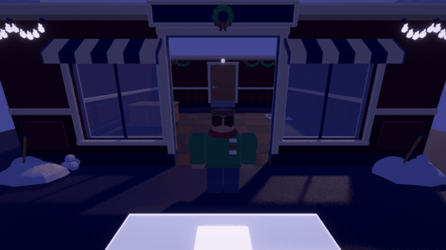
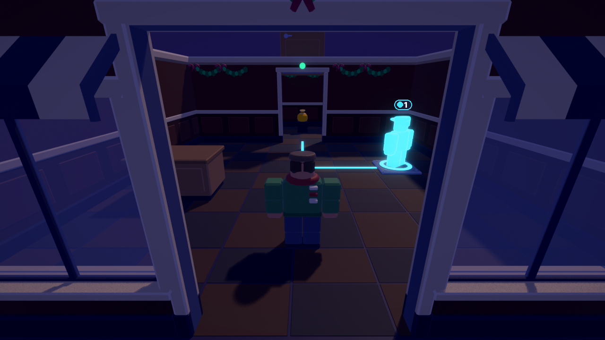
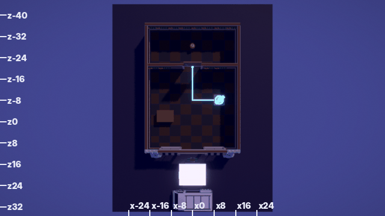 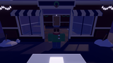

Also: [spawn with clone](levels/L1_cs1_back_room_1b_spawn_clones.png), [plan solved](levels/L1_cs1_back_room_3b_plan_solved.png), [street](levels/L1_cs1_back_room_5_street.png).

- **At spawn** you see a storefront, a shut wooden door at the back with a tiny red dot, and the white van slab under the camera. Plate A (10, -8) is hidden behind the right window. The cash (0, -28) is behind a solid wall, so MASTERPLAN §7.5's "cash glittering through glass" is not possible: the z -20 partition has no window.
- **On the plate (solved)** the link finally reads: the clone glows, the cable lights cyan to the door, the door lamp turns green, and the cash bag shows through the doorway. But the door leaf floats above the wall (G6), and the cash is a dark brown sack, about 25 px tall at 720p.
- **Density:** one counter in a 32 x 44 room. The back room is a bare box with one stand.
- **Top issues:**
  1. The plate is invisible and unlit at 0-8 s (G2).
  2. The cash is not visible or glinting from the front room (G4; no window).
  3. The spawn frame is dominated by the van zone and pinned to the van (G5).

### L2 "Two Doors"

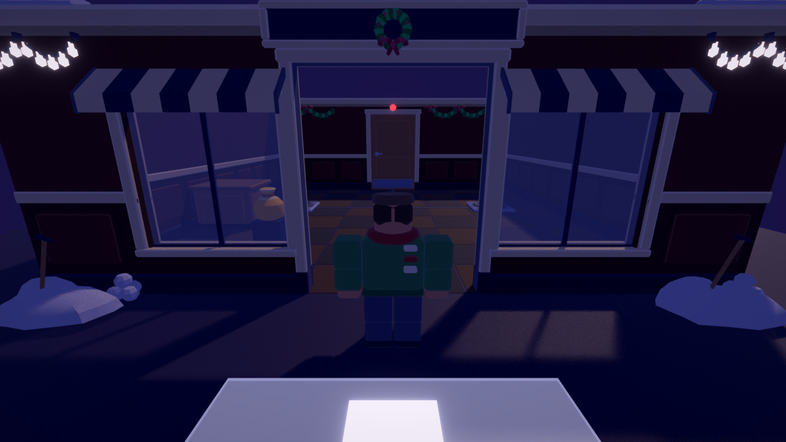
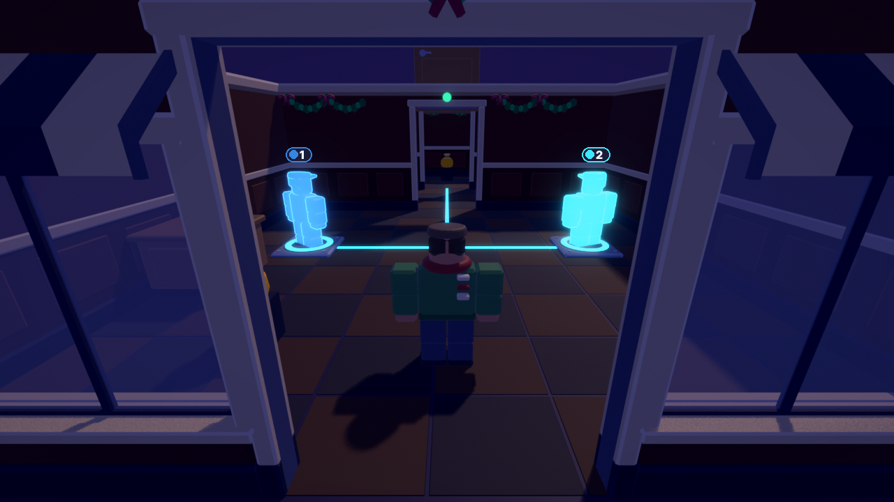
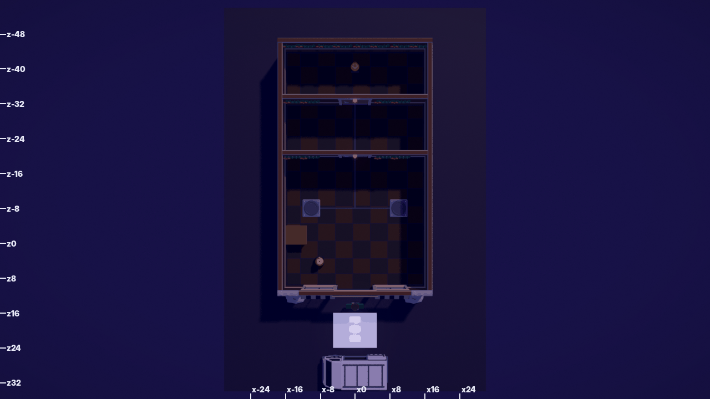 

Also: [spawn with clones](levels/L2_cs2_two_doors_1b_spawn_clones.png), [plan solved](levels/L2_cs2_two_doors_3b_plan_solved.png), [street](levels/L2_cs2_two_doors_5_street.png).

- **The level's whole lesson is "this plate → that door", and the world draws the opposite.** Both cables run to x 0 and then share one line north, forming a T in front of the first door. Plate B's cable passes under the BackRoom door to reach the Stockroom. Both plates and both cables turn the same cyan in solo.
- The doors are identical, with no letters, and the second door (z -32) is only visible once the first is open.
- The "Safe" is a sack on a stand at (0, -40). The kit `Safe` is unused.
- The middle room (z -20..-32) is an empty corridor.
- **Top issues:**
  1. The cable routing implies the wrong mapping (G3).
  2. No A/B identity on the plates or doors (G2, G12).
  3. The goal doesn't read as a safe, and it is unlit (G4).

### L5 "Clone Party" (third in play order)

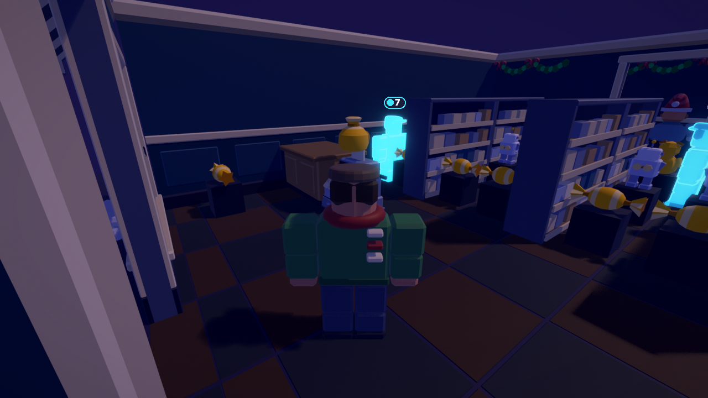
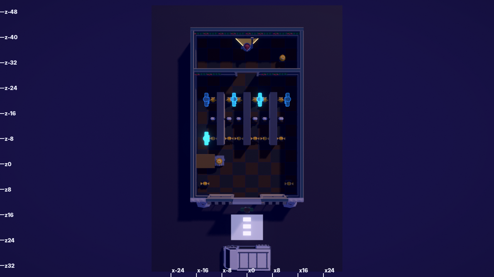 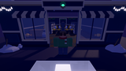

Also: [spawn with clones](levels/L5_cs5_clone_party_1b_spawn_clones.png), [plan](levels/L5_cs5_clone_party_3_plan.png), [street](levels/L5_cs5_clone_party_5_street.png).

- **This is the best read of the six.** Gold-wrapped candy and toys on rows through the door say "a shop full of loot" at once. The Toy Shop gondolas give the room a silhouette.
- **But** every loot item sits on its own 1.8-stud ink stand **in the aisle**, beside the shelf instead of on it. Each 6-stud aisle keeps a 1.2-stud gap between two rows of pedestals, and clones visibly walk through the stands, which are visual only. It reads as cluttered and fake.
- The **till**, the level's top loot and the Alarm Run trigger, is a register on the floor at (-8.5, -1), **outside** its counter box (KIT_IMPORT fit table). It has no light, and its "LOCKED 0:07" label is distance-limited. From the entrance it hides behind the player ([objective](levels/L5_cs5_clone_party_2_objective.png)).
- Gus dozes facing the office's back wall, and his cone is a 4-stud sliver.
- The open shutter floats above the storefront (G6). The shutter's green "open" lamp sits in the middle of the wreath, so the wreath appears to glow green.
- **Top issues:**
  1. The loot belongs on the shelves, not on aisle pedestals.
  2. The till is not staged as the finale: off its counter and unlit.
  3. The floating shutter (G6) is in the Line-up street shot.

### L3 "Lights Out"

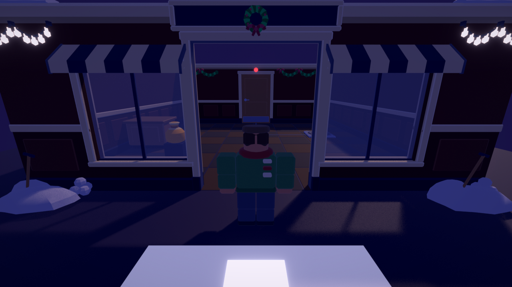
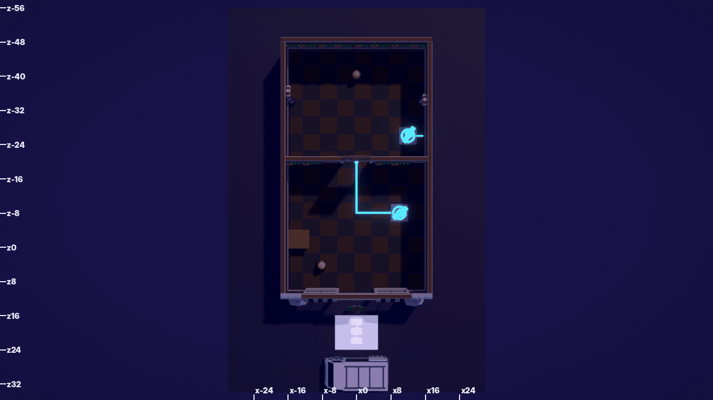
 

Also: [spawn with clones](levels/L3_cs3_lights_out_1b_spawn_clones.png), [toward the goal](levels/L3_cs3_lights_out_2_objective.png), [street](levels/L3_cs3_lights_out_5_street.png).

- From spawn, the level looks exactly like L1.
- The laser grid (z -34) is the brightest object in the plan, which is right for a hazard. **But plate B (12, -26), the plate that turns it off, has a cable that runs 4 studs east into the wall** (`deviceCenters` uses `laser.maxX + 0.5 = 16`, the wall line) and is never seen again. The HUD line names "Plate B", and nothing in the world is called B.
- The "Register" is a sack on a stand. The kit `CashRegister` is only used for top Cash loot.
- **Top issues:**
  1. There is no visible link from plate B to the grid (G3).
  2. No letters, but the text uses letters (G2).
  3. The first room is identical to L1 (G7).

### L4 "Night Clerk"

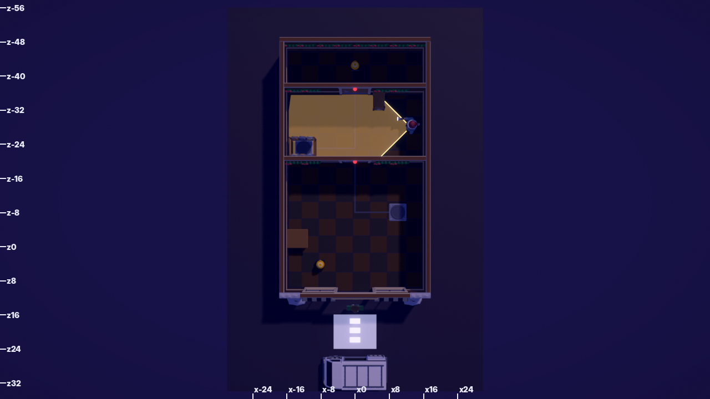
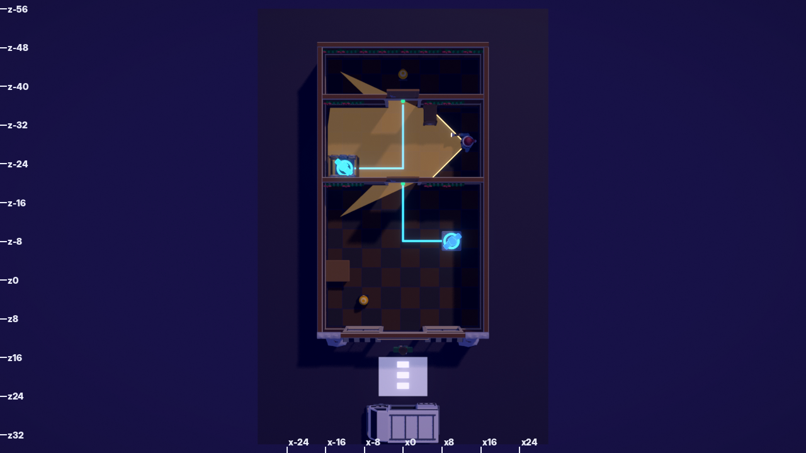
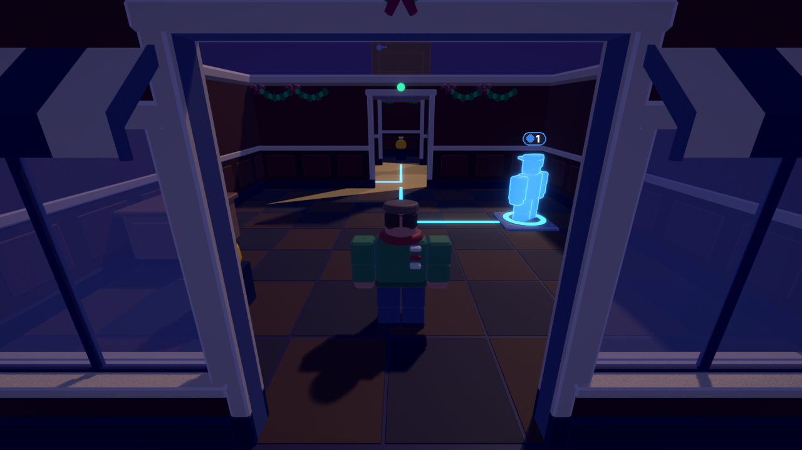 

Also: [spawn](levels/L4_cs4_night_clerk_1_spawn.png), [spawn with clones](levels/L4_cs4_night_clerk_1b_spawn_clones.png), [street](levels/L4_cs4_night_clerk_5_street.png).

- **Gus's cone is the best signal in the launch set.** You can see what he sees from above and through the open door ([objective](levels/L4_cs4_night_clerk_2_objective.png): the amber fan on the back-room floor).
- With both doors open, the 12-ray wedges paint amber **over the partition walls** into the shop and the safe room (G10).
- Plate B sits inside the coat rack's niche (-12, -23). Its cable is lit only when held. The rack itself looks like furniture, with nothing that says "walk in here".
- Gus's post has no prop: no desk, lamp or donut box.
- **Top issues:**
  1. Hides and the plate under the rack are not signposted (G9, G2).
  2. The cone leaks through walls (G10).
  3. The front room is again identical (G7), and the goal is again a sack behind two doors.

### L6 "The Big Score: Bank"

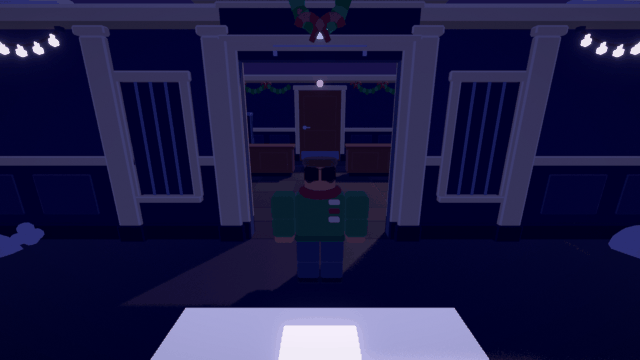
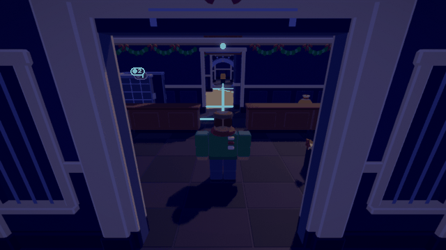
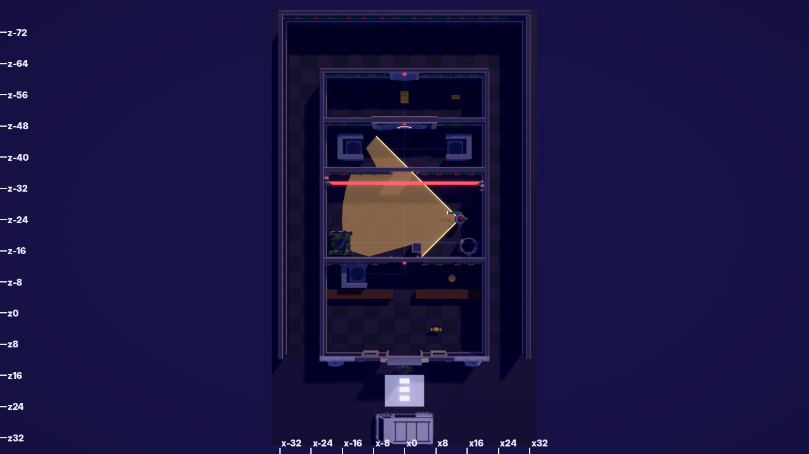
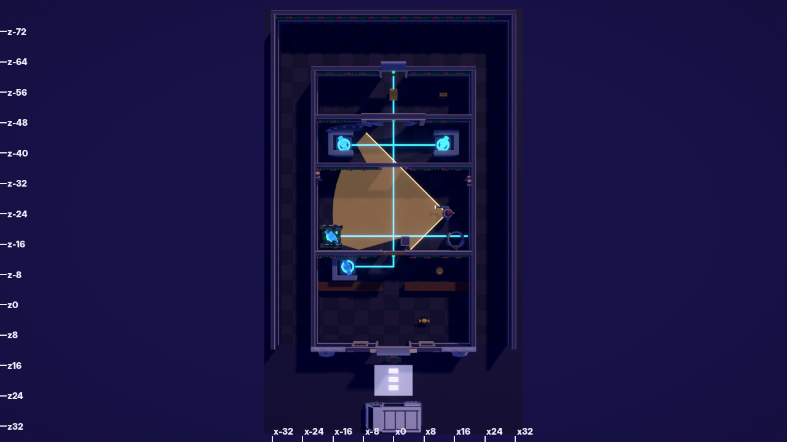 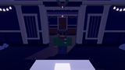

Also: [spawn with clones](levels/L6_bk1_big_score_1b_spawn_clones.png), [street](levels/L6_bk1_big_score_5_street.png).

- **The bank front has a real silhouette** (columns and pediment, with the vault glimpsed down the x 0 axis once all doors are open). In the objective shot, the lit cable spine accidentally becomes a leading line to the vault. That is the right idea, by accident.
- **What doesn't work:**
  - Four plates, three of them under furniture, feed one shared cable spine. The vault frame shows no "0/4 … 4/4" state.
  - Plate B (under the fern, west wall) sends its laser cable **east** across the whole hall to x 20, then into the east wall.
  - The open vault door rests on plate C and WestStack (KIT_IMPORT fit table, still open).
  - The lobby counters are the shop's `Counter_8x2` (the kit's `TellerCounter_8x4` with its glass screen is unused). The TellerDesk hide (-12, -10) has no cover piece.
  - The gold is about 70 studs from spawn, behind three walls, with no light.
  - The fenced alley looks like an interior corridor (G11). The shutter floats above the pediment (G6).
- **Top issues:**
  1. The "need all 4" rule is invisible: no per-plate lamps on the vault and no distinct cables (G3, G12).
  2. Cable routing for B and the vault (G3).
  3. No hero lighting on the vault and gold, and no lobby → vault sightline staging (G1, G4).

---

## 3. Comparison, honestly

| | Heist Yourself today | Monaco / Hitman GO / Sly Cooper | Top Roblox (Doors, Piggy, Entry Point, Jailbreak robberies) |
|---|---|---|---|
| Where to go | Text line only (6 s) | Hitman GO: the goal tile is flagged and visible from move 1. Monaco: the floor plan with an icon on every objective | Doors: the next door is lit and numbered. Entry Point: objective outline and marker |
| What a switch does | Same-hue cable that merges or hides in walls | Hitman GO: everything sits on visible node lines. Sly: interactives sparkle blue | Piggy: the red key fits the red door (colour pairing) |
| Light | None, uniform ambient | One key light plus pools, so objectives sit in light | Lit paths, dark sides |
| Density | Shell plus gameplay boxes | Every room has a purpose prop and a storytelling prop | Dense props, layered silhouettes |
| Thumbnail read (160x90) | The same storefront x4, a white slab | Single strong focal point | Saturated, one hero |

The art style (STYLE_BIBLE "Neon-Noir Diorama", which explicitly cites Hitman GO and Monaco) is right. The levels skip the two cheap things those references rely on most: **a lit focal point per room** and **a visible, unambiguous link from every switch to its device.**

---

## 4. Prioritized fixes

Tuning numbers go in `src/shared/Config.luau` (CLAUDE.md). Level-data changes (new solids, moved plates) must keep `lune run tests/run_sim.luau` green and update `tests/sim/Solutions.luau` where a position moves. Positions are level space (Roblox studs; floor y 0, walls 12).

### P0: before launch (comprehension and visible bugs)

**P0-1. Plates glow idle and carry a letter, and their devices carry the same letter.**
- **`src/server/Heist/KitDresser.luau` (plate swap):** keep a plate icon after the swap. Either move the greybox `Icon` to the kit plate before `old:Destroy()`, or add a `SurfaceGui`/`Decal` with the plate's `def.id` letter in Getaway White on the top face (y 0.36).
- **`src/client/Heist/WorldView.luau` (plates, idle):** rim in Neon **Bulb Warm `#F6C0A2`** at 50 % transparency, with a slow breathe (≤ `BLINK_HZ_MAX`, steady under reduced motion). On press it turns the clone hue. Bulb Warm is already the audited N1 idle for lamps and fairy lights: Oklab 0.207 / 0.274 / 0.389 / 0.152 from clone P1-P4 (`eh_palette.ok_dist`). Warm Marble `#D8C8A8` would be 0.150 from Ghost White and 0.086 from Torch Amber, so don't use it. Add it to `eh_palette.NEON` and re-run `python3 tools/blender/eh_palette.py`.
- **`src/server/Heist/LevelBuilder.luau`:** a letter plaque, a 1.6 x 1.6 steel disc with an ink letter, on each device the plate drives:
  - on the door frame header face, next to the lamp at (door cx ± 2, 10.8, line + 0.6), on both faces;
  - on the laser's near post at 7 studs high.

**P0-2. Visible, honest cables.**
- **`LevelBuilder.cable`:** make idle cables 0.5 wide in Vault Steel `#7C86A6`. Route each one to the device's **near jamb** (door: x = cx ∓ 3.5 on the plate's side; laser: the end post nearer the plate, i.e. `minX - 0.5` when the plate's x < laser centre), not the centre.
- **Offset parallel trunks** by plate index (x = -1.5, -0.5, 0.5, 1.5) so they never share a line.
- Keep cables **1.5 studs off any wall line**: kit walls cover the wall band.
- Concretely:
  - **L2:** A runs from (-10, -8) along z -8 to x -2.5, then to the west side of the BackRoom doorway (-2.5, -19). B runs from (10, -8) along z -8 to x 2.5, then along x 2.5 **through** the BackRoom doorway to the east side of the Stockroom doorway (2.5, -31). The two lines never touch, and B's visibly passes the first door.
  - **L3:** B runs from (12, -26) straight along x 12 to z -32.5, just in front of the grid, then along z -32.5 to the east post's base at x 15. Today it stops at (16, -26), inside the east wall.
  - **L6:** B runs from (-16, -18) along x -16 to z -32.5, then to the grid's **west** post (-19, -32.5). A, B, C and D enter the vault frame at x -1.5, -0.5, 0.5, 1.5.

**P0-3. Light the objective, the plates and each room.**
- **New `lamp` role in `src/server/Heist/KitPlan.luau`**, placed by `KitDresser`: `Lamp_Ceiling` (pivot at y 12) plus a `PointLight` on `Lamp_Ceiling_Bulb`. Use Bulb Warm `#F6C0A2`, `Shadows = false`, with Range/Brightness from a new `Config.Heist.LAMP = { range = 16, brightness = 1.2, heroRange = 22, heroBrightness = 2.2, heroShadows = true }`.
- Each lamp also gets a **Warm Marble disc** (Transparency 0.7, 10 wide, y 0.03) under it. This is the phone/no-shadow pool from STYLE_BIBLE §3.
- **Rules:** one lamp per plate (directly above it); one **hero** lamp (the only one with shadows, ≤ 4 per view) over the goal loot; one per room centre without either.
- **Positions:**

| Level | Lamps |
|---|---|
| L1 | (10, -8) plate; (0, -28) hero; (-10, -2) counter |
| L2 | (-10, -8), (10, -8) plates; (0, -26) middle room; (0, -40) hero |
| L3 | (10, -8), (12, -26) plates; (0, -40) hero; the grid keeps its own glow |
| L4 | (10, -8), (-12, -23) plates; (13, -30) Gus's post; (0, -42) hero |
| L5 | (-4, -14), (4, -14) aisles; (-12.5, -1) till hero; (0, -34) office desk lamp |
| L6 | (-12, -10), (-16, -18), (-13, -42), (13, -42) plates; (0, -6) lobby; (0, -24) hall; (0, -55) gold hero (spot down); (0, -42) scale room |

**P0-4. The goal reads as loot from where you stand.**
- **`WorldView` (loot at Home):** a Heist Gold sparkle (BillboardGui star or 2-3 Neon facets, ≤ 3 flashes/s) on every item of value ≥ 100 and on `top` items. Add a light shaft or a hero lamp (P0-3) over the goal.
- **Use the right displays.** Add an optional `display = "Safe" | "CashRegister" | "Counter"` field to loot specs and teach KitPlan to place the display under it. Then:
  - L2 `Safe` at (0, -41.5) against the back wall, on `Safe`;
  - L3 `Register` at (0, -40), on a `CashRegister` on a `Counter_8x4`;
  - L4 `NightDeposit` at (0, -42), on `Safe`.
- **L1:** let the player see the cash. Add `kit = "window"` support for solids in `KitPlan` (tile `Wall_Window_8x12` on those runs). In `src/shared/Levels/L1_BackRoom.luau`, mark the two partition solids at z -20 (x -16.5..-3 and 3..16.5) as windows. L1 has no Gus, so the glass doesn't change any sight rules. This delivers MASTERPLAN §7.5's "cash glittering through glass".

**P0-5. Fix the floating doors and shutters.**
- **`src/client/Heist/WorldView.luau` (door update):** open `Wall_Door_8x12_Leaf` doors as **pocket doors**, sliding `height`-wide along the wall run toward the hinge side (STYLE_BIBLE §5.2), not up.
- Roll `Shutter_8x10` up by `Size.Y` (top pinned, 10.35 → 0.35) as KIT_IMPORT specifies.
- This removes the slab over every open door and the "billboard" shutter in L5 and L6. It also matters in the Line-up street shot (MASTERPLAN §6.6).

**P0-6. Spawn framing and the van zone.**
- **Client camera module:** on run start, set `CameraMinZoomDistance` 8, `CameraMaxZoomDistance` 28, zoom 16 and pitch 20°, facing the shop (MASTERPLAN §3.5). Add the wall fade.
- **`LevelBuilder` / `WorldView` VanZone:** Transparency 0.85, no Neon, while the local player is not carrying loot. Light it fully, with true arrow meshes or decals pointing at the van (not 0.08-tall WedgeParts that read as bars), only while carrying.
- **[verify in Studio]** where the default camera ends up at spawn (z 26.1, y 7.7 vs the van roof at y 7.69). If it clips into the van, move the van 4 studs back in `Shop.VAN` (z 20..28 is a data change; Line-up z 28 is already an open item in MASTERPLAN §6.6) or start the camera with pitch 25°.

### P1: launch quality (density, identity, signposting)

**P1-1. Give each Corner Shop level its own first room.** Add new solids in `src/shared/Levels/L1..L4`, each a `Shelf_8x2` box 2 x 7.85 x 8 against a wall, which KitPlan already dresses as `Shelf_8x2` (`h >= 5`, `short <= 3`). All boxes below keep 2+ studs from every plate, door gap, loot point and Gus route. Check them with `lune run tests/run_sim.luau`.
- **L1:** west wall x -15.5..-13.5, z -18..-10; east wall x 13.5..15.5, z -18..-12; `Gus_DonutBox` on the counter at (-10, 3.5, -2) (visual, the room's storytelling prop).
- **L2:** east wall x 13.5..15.5, z 0..8; west wall x -15.5..-13.5, z -18..-12; middle room both walls x ±(13.5..15.5), z -30..-22.
- **L3:** east wall x 13.5..15.5, z 0..8; back room **west** wall only, x -15.5..-13.5, z -30..-22. Plate B at x 10..14 rules out the east wall there.
- **L4:** Gus's desk as a low counter, x 12.5..15.5, z -34..-32, `sight = false` (it is behind him at his first stop), with the donut box and his post lamp (P0-3).

Don't use hide pieces (`Hide_Crate`, `Hide_CoatRack`) as decoration: that breaks "interactive vs decoration" (G9). Also give each level a different counter position, or a sign colour from the location atlas. The aim is a different silhouette in the spawn view, so the four thumbnails stop being the same image.

**P1-2. Hide affordance.** In `LevelBuilder`, keep a Warm Marble floor outline (0.2-wide frame at y 0.03) of every `EH_Hide` volume. In `WorldView`, add a "◐" billboard within 12 studs. L4's plate B and L6's B/C/D then read as "go in there". For L6 TellerDesk, add the missing cover piece (`Hide_DepositStack`, open side to the counter; KIT_IMPORT).

**P1-3. L6 "need all 4" readout.** In `LevelBuilder`, put 4 lamps in a row on the vault frame's front face, at x -3, -1, 1, 3, y 10.5, z -47.3, lettered A-D. Each one turns the presser's hue while its plate is held (in `WorldView`, from the same plate attributes). Use `TellerCounter_8x4` for the lobby counters (KitPlan: `party == false and location == "Bank"` → TellerCounter). Move plate C and the WestStack hide 3 studs toward the street, to z -39 (plate box z -41..-37), so they leave the vault door's resting footprint (z -46.8..-42.25; KIT_IMPORT fit table). Update `Solutions.bk1_big_score`.

**P1-4. L5 loot on the shelves.** In `src/shared/Levels/L5_CloneParty.luau`, change the shelf loot x to `x ± 1.4` with `y = 3`. In `KitPlan`/`LevelBuilder`, skip the ink stand when the loot point lies inside a shelf solid's footprint ± 0.5 (the gondola is the dark display). Move the till onto the counter: the counter box is -15.5..-10, so put the till at (-12.5, -1) and widen the counter box to x -15.5..-9 (KIT_IMPORT fit-table item). Give it the hero lamp (P0-3).

**P1-5. Gus's cone without leaks.** In `src/client/Heist/GusView.luau`, use 24 rays (or 12 plus 1 extra ray at each solid corner inside the fan), and draw each wedge only to the shorter of its two rays (no wedge spans a hit/miss boundary). The cost is still 10 Hz.

**P1-6. Street dressing** (a new `street` pass in KitPlan, visual only):
- a kerb and road strip at z 12..34 (two `Floor_8x8` runs in a street atlas cell);
- one street lamp with a real PointLight at (-9, 0, 15), so the spawn stands in a warm pool;
- a painted shop sign in the storefront's empty sign band (emissive mask, not Neon; the 3-SurfaceAppearance budget allows it);
- 2 dark backdrop facades at x ±40.

For L6, floor the alley with a street cell and use a low fence piece instead of `Wall_8x12` for the lot fence.

### P2: polish

- **P2-1.** Make the Christmas layer dimmer than the signals: fairy lights at Neon Transparency 0.3, and never above a plate or a door lamp (STYLE_BIBLE §13 "never over a laser post" extended to every signal).
- **P2-2.** Door lamps: a 1.6 x 0.6 bar on both faces of the frame instead of a 0.8 ball on one face.
- **P2-3.** One storytelling prop per room (STYLE_BIBLE §5 rule), e.g. a mop bucket, a staff calendar or a lost teddy. Put them in `Levels/*` as `props = {...}` data, placed by KitPlan as visual only.
- **P2-4.** A Planning camera (MASTERPLAN §3.5, "simple version at launch") does not exist. `3_plan` shows what it would see. Even the simple version needs P0-1/P0-2 to be useful.
- **P2-5.** Re-run `tools/blender/level_shots.py` after each fix as the regression check. Spawn-view brightest-2 % should land on the plate, the goal or a lamp, not the van zone. Then confirm with Studio B1/B2 screenshots (STYLE_BIBLE §7).

---

## 5. What already works (keep it)

- The kit pieces: trims continue across modules, bevels catch light, and the Bank front has a real silhouette.
- Lit cables and clone glow **when active**. The 1b/2/3b shots read clearly; the problem is the idle state.
- Gus's amber cone (L4, L6).
- L5's gold loot rows seen through the door.
- The laser grid's red against the indigo.
- Placement maths: every kit piece lands within 0.0005 studs of KitPlan's frame, with no gaps or z-fighting in any render.
