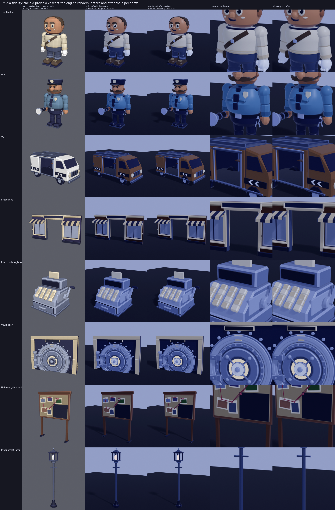

# Studio fidelity: why the kit looked worse in the engine than in Blender

_2026-11-13, branch `studio-fidelity`. Owner: "Everything in Studio, model-wise, looks 100x worse in Studio than in Blender. Fix it." Evidence: a close-up of the first-person glove (hard facets, seams, dark purple)._

**Short answer.** The engine was not breaking the meshes. It rendered exactly what we sent it (measured below). What we sent had **flat-shaded normals on most curved surfaces**, and our Blender previews **hid that** (Workbench studio light, cavity and a black outline make facets look like crafted edges). Under the game's lighting, the SmoothPlastic highlight and the cool ambient picked out every facet. On top of that, the atlas UVs **bled into neighbour colours on far or low-texture-quality draws**. The pipeline now ships round normals on revolved surfaces, safe atlas UVs and Precise render fidelity on the hero pieces. A Roblox-faithful Blender preview makes the same mistake visible before it reaches the game.

How each suspect was measured:
- `tools/blender/fidelity_audit.py` parses every exported FBX, the file Roblox receives, not the Blender scene.
- The engine readout ran in a real server (Open Cloud Luau Execution on place version 143). It loaded the kit through `KitService`, then read each MeshPart's mesh back with `AssetService:CreateEditableMeshAsync(part.MeshContent)`.

## Root causes, ranked

| # | Cause | Evidence | Fix |
|---|---|---|---|
| 1 | **Flat normals on curved surfaces** (authoring rule). `eh_kit.finalize` hardened every edge sharper than 30°. A revolved surface with *n* sides has 360/*n* degrees between faces: 10-sided limbs (36°), 8-sided knobs (45°) and 6-sided fingers (60°) all came out fully faceted. | FBX audit: 252 of 298 meshes are curved; their curved faces were **41% flat on average**, and **105 meshes were ≥ 50% flat**. The engine readout gave the same numbers (table below). | Revolved primitives mark their circumference edges as "soft". Soft edges stay smooth up to 75° (`eh_kit.SOFT_MAX_DEG`); boxes, chamfers and 90° corners stay hard. Kit re-exported. |
| 2 | **The Blender preview lied.** Turntables used Workbench `paint.sl` studio light + cavity + object outline + Closest texture filtering; marketing and golden frames used per-shot area lights, AO, bloom and exposure. None of those exist in the engine. | `docs/audit/studio_fidelity/before_after.png`, column 1 vs column 2: the same old FBX. | `tools/blender/roblox_look.py`: a Roblox-faithful mode that reads `default.project.json`. `fidelity_sheet.py` renders before/after with it. |
| 3 | **Atlas UV bleed.** Every face got an 8 px UV circle inside its 32 px cell of the 256 px atlas, so from mip 3 (32 × 32) bilinear filtering mixed in the neighbour cell. The engine drops to those mips on far or small faces and on devices at low texture quality. The result is odd tints on distant or small parts and a dirty, muddy look on phones. | Engine: the atlas arrives at 256 × 256 (EditableImage). All 64 cells of all 3 atlases are solid colours (checked per pixel). | UVs now sit within 1 px of the cell centre (`eh_palette.UV_HALF_PX`): the exact cell colour is sampled at every mip down to 8 × 8. |
| 4 | **Cool, purple-leaning ambient on a white-tinted SmoothPlastic kit.** | `OutdoorAmbient` (0.63, 0.67, 0.80), `ColorShift_Top` (0.59, 0.69, 1.0) and `Ambient` (0.46, 0.48, 0.60) all lean blue-violet. Shadowed faces (most of a first-person hand, from above) show mostly ambient. The faithful preview reproduces the cast. | **Not changed here** (the lighting was just tuned on main). Per-part materials are already right: SmoothPlastic, Color white, the atlas carries the colour. See "For the lighting owner" below. |
| 5 | **RenderFidelity Automatic on hero pieces.** No effect close up (full detail under ~250 studs). It mattered only for the skyline and the intro tower seen from far away. | Engine: all 298 pieces were Automatic. The rebuild passed the imported value through. | `Config.Kit.PRECISE_PREFIXES` (Rookie_, Gus_, Hoardsworth_, VaultDoor_, Intro_Tower, Van*), chosen at the `CreateMeshPartAsync` rebuild through `KitLib.renderFidelity`. |

Ruled out (measured):
- **Normals lost on import or in the rebuild.** The engine's corner normals match the FBX: Rookie_LeftFoot 1.00 / 1.00, Storefront 1.00 / 1.00, Van 0.92 / 0.91, Rookie_Hand_Left_Palm 0.13 / 0.15 (flat share, FBX / engine). The raw `LoadAsset` part and the `CreateMeshPartAsync` rebuild read identically: Rookie_Head 0.354 / 0.354, Rookie_LeftLowerArm 0.667 / 0.667.
- **Decimation.** Engine triangle counts equal the FBX exactly (Rookie_Head 644, Van 1,704, VaultDoor_Door 3,832).
- **Scale or pivot distortion.** 0 size errors and 0 position errors on 298/298 pieces, so the `part.Size = spec.size` fallback never ran.
- **Vertex colours.** No FBX carries a colour layer (0 / 298), and none of the kit's Blender materials uses one.
- **Missing or wrong atlas.** Every atlas piece wears the uploaded atlas id. Neon and glass pieces carry none, as specified.

## Suspect by suspect

### 1. Normals and smooth shading

- **Export.** `bpy.ops.export_scene.fbx(..., mesh_smooth_type="OFF", use_mesh_modifiers=True)`. "OFF" still writes one normal per face corner (`LayerElementNormal`, `ByPolygonVertex`, `Direct`). It only skips the smoothing-group layer. Roblox reads those corner normals (proven below), so no export setting needs to change.
  - Triangulation is done in `finalize` (BEAUTY, n-gons only). Blender then triangulates quads on export.
  - There are no tangents (`use_tspace` off) and nothing uses a normal map; that is fine.
- **Authoring (the bug).** `finalize(shading="angle", angle=30)` marked every edge above 30° sharp. That rule is right for boxes and 45° chamfers. On a revolved surface it is wrong whenever the surface has 12 sides or fewer. Most limbs, fingers, knobs, posts, tyres, lamp heads and bottles have 6 to 10 sides.

Engine readout, v143, before the fix. Flat corners = the share of corner normals equal to their face normal, read with EditableMesh; 1.0 means fully faceted.

| Piece | Tris | Flat corners, FBX | Flat corners, engine |
|---|---|---|---|
| Rookie_LeftFoot | 152 | 1.00 | 1.00 |
| Rookie_LeftLowerArm | 120 | 0.71 | 0.67 |
| Rookie_Hand_Left_Index2 | 128 | 0.72 | 0.75 |
| Gus_Head | 560 | 0.53 | 0.56 |
| Van | 1,704 | 0.92 | 0.91 |
| CashRegister | 1,032 | 0.95 | 0.95 |
| Storefront_24x12 | 1,980 | 1.00 | 1.00 |
| VaultDoor_Door | 3,832 | 0.64 | 0.60 |
| Diamond (faceted on purpose) | 94 | 1.00 | 1.00 |

The engine's own triangulation explains the small gaps between the two columns.

**Fix.**
- `eh_kit.MB.lathe` (and so `cylinder`, `sphere` and every spec built on them) and `_kitlib.tube` mark the edges around the circumference `soft`. `sphere` also marks its latitude rings.
- `finalize` smooths an edge when its angle is < 30°, or when it is soft and < 75°.
- Primitives with fewer than 6 sides stay faceted, as do `soft=False` and `shading="flat"`. The Diamond is built with explicit faces and `shading="flat"`, so it stays a cut gem.
- The corner normals are now part of the build's content hash (`build_asset.py`, `EXPORT_VERSION fbx-2`), so a smoothing change can never be skipped as "unchanged".

**After the fix.** Measured by the FBX audit over all 298 meshes, and in the engine on Saved v148:

| Measure | Before | After |
|---|---|---|
| Curved meshes: mean flat share of their curved faces | 0.41 | 0.24 |
| Curved meshes that are >= 50% flat | 105 | 62 |
| Whole kit: mean flat corners | 0.63 | 0.51 |
| Whole kit: triangles | 130,418 | 130,418 |

Per piece, flat corners (curved faces in brackets):

| Piece | Before | After |
|---|---|---|
| Rookie_LeftLowerArm | 0.71 (0.50) | 0.43 (0.00) |
| Rookie_LeftLowerLeg | 0.86 (0.75) | 0.43 (0.00) |
| Rookie_Head | 0.34 (0.31) | 0.20 (0.13) |
| Gus_LeftLowerArm | 0.86 (0.75) | 0.43 (0.00) |
| Gus_LeftHand | 0.31 (0.15) | 0.00 (0.00) |
| Gus_Flashlight | 0.88 (0.71) | 0.59 (0.00) |
| Hoardsworth_LeftLowerArm | 0.79 (0.60) | 0.47 (0.00) |
| VaultDoor_Dial | 0.43 (0.18) | 0.30 (0.00) |
| Xmas_Tree | 0.38 (0.27) | 0.18 (0.00) |
| Snowman | 0.49 (0.28) | 0.21 (0.00) |

On the "after" side, the flat corners that remain are on caps and on hard edges that are meant to be hard.

The engine reads the same on Saved v148 and v150 (`kit_engine` B2, EditableMesh): Rookie_LeftLowerArm **0.33** (was 0.67), Rookie_LeftUpperArm 0.11 (0.33), Gus_LeftHand 0.00 (0.35), Gus_LeftLowerArm 0.33, Gus_Flashlight 0.50, Hoardsworth_LeftLowerArm 0.38, Snowman 0.18.

**What stays flat, on purpose or by method:**
- Hard-surface pieces built from chamfered boxes and prisms: walls, counters, floors, the van body panels, the cash register, the shop front.
- The Diamond (a cut gem).

The audit's "curved" test also counts a chamfer's corner triangles (about 35 degrees), so 32 meshes still trip `--gate`. Every one of them is a box or prism piece, or the Diamond. None is a revolved surface.

### 2. Vertex colours and materials

| Blender side | Reaches the game? |
|---|---|
| Kit material `EH_KitAtlas`: Principled, Base Color = the atlas image (Closest), Roughness 0.7, Metallic 0 | Only the image does: it is the MeshPart `TextureID`. The engine applies its own SmoothPlastic response. |
| Hero material (vault dial face): its own colour map | Yes, as a SurfaceAppearance (colour, roughness, emissive) cloned by KitService. |
| Vertex colours | None in the kit (0 colour layers in 298 FBX meshes). Note for fp-hands-v2: Roblox *does* multiply FBX vertex colours into the MeshPart colour, and Studio's importer has an "Ignore Vertex Colors" toggle. |
| Preview-only materials (`kit_preview._mat`, marketing `Coat`, emission on lamps, AO, bloom) | No. These exist only in renders. |

Nothing the kit itself relies on is dropped. The gap came from the preview renders (cause 2), not from the kit's materials.

### 3. Textures and the atlas

- **Resolution.** The atlas arrives at 256 × 256 (EditableImage on the Bank atlas id). The per-location atlas swap sets the right image: 298/298 pieces, and every `KitService.atlas(loc)` id is a real image.
- **Compression.** Every cell is a solid 32 px colour aligned to 4 × 4 blocks, so block compression keeps each cell flat. Only RGB565 quantisation remains: up to about 1/64 per channel on dark cells.
- **Mipmaps.** This was the real risk, see cause 3. With UVs at the cell centre ± 1 px, the cell's own colour is sampled exactly down to the 8 × 8 mip.

### 4. Material choice

- Every opaque kit piece is SmoothPlastic with `Color` white and the atlas. That is the right base for a flat-palette kit:
  - `Plastic` adds a noise normal pattern, which fights the flat look.
  - `Reflectance` stays 0, so the cool sky never mirrors into the atlas.
  - Neon (idle colour, no texture) and Glass (tint, transparency) are as specified.
- The colour cast is the lighting (cause 4). Under the game's `EnvironmentSpecularScale` 0.25, the SmoothPlastic highlight is exactly what made flat facets visible. Round normals fix that without a material change.
- No per-part material change was needed. `kit_engine` B2 now asserts the manifest material on all 298 pieces.

### 5. RenderFidelity and LOD

- `Workspace.MeshStreamingAndImprovedLoDs` does not exist in this engine version (reading it errors), so `RenderFidelity` is honoured.
- Automatic gives full detail under ~250 studs, so it is not the close-up problem.
- Precise is now set for the characters, the vault door, the vans and the intro tower. The characters reach ~250 studs in the Line-up and the intro; the intro tower and vans are seen from far away.
- **Perf:** Precise changes nothing inside 250 studs, which is where every gameplay camera is. Triangle counts are unchanged by this whole fix: the same mesh, new normals. See "Perf impact".

### 6. Mesh density

The engine received exactly the FBX triangle counts, so nothing was decimated. Bevels survive: 1-segment chamfers are real geometry. Low side counts (6 to 10) still show as a polygonal *silhouette* on the hand and limbs at first-person distance. Smoothing fixes the shading, not the outline. Adding sides is a per-asset art call, so it is left to the asset owners. The fp-hands-v2 rebuild already moves the hands to a sculpted skinned mesh.

### 7. Scale and pivot

0 size errors and 0 position errors on 298/298 pieces (v143). The size-mismatch fallback (`part.Size = spec.size`) never ran, so no mesh is stretched.

### 8. An honest Blender preview

`tools/blender/roblox_look.py` (`apply(scene, objs, location, interior)`, `grade(png)`):
- **Colour.** Colour = atlas texture with **bilinear** filtering × the MeshPart `Color` that KitService gives (`kit_docs.idle_colour`). No vertex colour, no procedural nodes.
- **Surface.** SmoothPlastic = a dielectric BSDF with roughness 0.42. Neon = emission; Glass = alpha.
- **Normals.** The FBX's own split normals: the importer keeps custom normals, and those are the ones the engine draws.
- **Light.** One sun at the game's `ClockTime` / `GeographicLatitude` elevation, at `Brightness`, tinted by `ColorShift_Top`, plus a uniform world of `OutdoorAmbient` (or `Ambient` indoors). No AO, no outline, no cavity.
- **Grade.** The game's `ColorCorrectionEffect` (contrast, saturation, tint) is applied after rendering. Every value is read from `default.project.json`, so a lighting change on main flows straight into the preview.
- **Stated approximations.**
  - The engine tone curve is approximated with ACES 1.3.
  - `EnvironmentDiffuseScale` is folded into the ambient.
  - Eevee shadows are used.
  - For a preview, the sun's azimuth (not its elevation) swings to light the camera side.

`tools/blender/fidelity_sheet.py --before <old fbx dir>` renders `docs/audit/studio_fidelity/before_after.png`. Rows: the Rookie, Gus, the van, the shop front, the cash register, the vault door, the hideout job board and a street lamp. Columns:
1. The old preview.
2. Faithful on the old FBX.
3. Faithful on the new FBX.
4. and 5. 2× close-ups of 2 and 3.

**What the sheet shows, honestly:**
- **Column 1 against column 2 is most of the "100x worse".** The same mesh goes from cream / white / gold under the studio light to a blue-violet cast under the game's Lighting. Facets that the cavity drew as crafted edges come out as plain flat faces.
- **Column 2 against column 3 is the pipeline fix.** Limbs, hands, the flashlight, the dial, the lamp head and the tree read round instead of banded. The difference is clearest in the 2x close-ups (Rookie arms, Gus's sleeves and hand) and in first person.
- **The remaining blue-violet cast is the Lighting, not the meshes** (cause 4, not in scope here).
- **The van body is brown** in the faithful columns because `Van_Paint` is a runtime-coloured part: KitService gives it its idle colour, and the hideout recolours it per van style. The studio preview showed the atlas white.

## The fixes

| Where | Change |
|---|---|
| `tools/blender/eh_kit.py` | `SHARP_DEG` 30, `SOFT_MAX_DEG` 75, `SOFT_MIN_SEGS` 6. `MB.soften`. `lathe` / `cylinder` / `sphere` take `soft=` (default on). `finalize` smooths soft edges up to 75°. |
| `assets/blender/_kitlib.py` | `tube` softens its circumference and its gentle path bends. |
| `tools/blender/eh_palette.py` | `UV_HALF_PX = 1`: UVs at the cell centre ± 1 px (was ± 8 px). |
| `tools/blender/build_asset.py` | `EXPORT_VERSION fbx-2`; corner normals in the content hash. |
| `src/shared/Kit/KitLib.luau`, `src/server/Kit/KitService.luau`, `Config.Kit.PRECISE_PREFIXES` | `KitLib.renderFidelity`. The rebuild uses it, and it also triggers a rebuild when only RenderFidelity differs. Comment: the rebuild keeps normals (measured). |
| `tools/blender/fidelity_audit.py` | Audits the FBX normals; `--gate` fails on a curved mesh that ships flat normals. |
| `tools/blender/roblox_look.py`, `tools/blender/fidelity_sheet.py` | The faithful preview and the before/after sheet. |
| `tools/blender/turntable.py` | The bottom-right tile of every turntable is now the Roblox-faithful render (it was the flattering "Heist Night mood" tile). The studio rows are labelled as a shape review only. All 97 rebuilt turntables were re-rendered. |
| `tests/kit_engine.luau` B2 | Per piece: material, atlas TextureID where textured, RenderFidelity rule. Per curved sample: EditableMesh flat corners under a ceiling. |
| `tests/unit/KitLib.spec.luau` | `renderFidelity`. |
| Kit | Rebuilt (`build_asset.py --all`), re-uploaded under **new** ids (`kit_upload.py --new`), `KitData` / kit docs / the kit_engine table regenerated. |

**New ids** (`kit_upload.py --only <97 groups> --new`, all moderation Approved; the old ids moved to each entry's `history` in `assets/kit_ids.json`):

| Group | New id |
|---|---|
| Rookie | 117436482372643 |
| Gus | 116363918374646 |
| Hoardsworth | 72521842741137 |
| Van | 91214118094893 |
| VaultDoor | 90916123034782 |
| Storefront_24x12 | 103589756688620 |
| CashRegister | 103310876103897 |
| JobBoard | 75018872592118 |
| StreetLamp | 74172021833368 |

The other 88 groups are in `src/server/Kit/KitData.luau`. These are the ids of the second `--new` upload: a `--no-render` gate run re-exported every FBX, and Blender's FBX bytes are not deterministic, so the files were uploaded again under fresh ids to keep the `kit_ids.json` hashes honest. The first batch of new ids is in each entry's `history`. Not re-uploaded: Rookie_FPArms, Rookie_Viewmodel and Rookie_Hands, which keep their FBX and ids for fp-hands-v2. The atlases and the hero appearance are unchanged: the atlas PNGs did not change.

## For the FP hands (branch `fp-hands-v2`): what to apply

The hands were left alone here (Rookie_FPArms, Rookie_Viewmodel and Rookie_Hands keep their old FBX and ids). Their FBX audit shows the same disease: Rookie_Hand_*_Index2 / Fingers2 / Thumb2 are 0.67 flat on their curved faces, and the engine reads 0.75. These pipeline facts apply to the skinned glove:
1. **The engine renders the FBX's corner normals exactly** (EditableMesh readout), so whatever smoothing Blender exports is what the player sees. Export with smooth faces and no sharp edges on the glove (or an auto-smooth / weighted-normal pass applied before export); `mesh_smooth_type="OFF"` is fine.
2. Check with `python3 tools/blender/fidelity_audit.py "assets/fbx/Rookie_FPHands*.fbx"`: curved flat corners should be about 0.
3. `CreateMeshPartAsync` keeps normals, so a rebuild for collision or RenderFidelity is safe. A skinned MeshPart may not need a rebuild at all.
4. If the glove uses vertex colours, `MeshPart.Color` multiplies them; keep `Color` white and put the glove colour in the vertex colours or in a texture.
5. Today's hand pieces carry **no** TextureID (`atlas: false`, tinted by `Color`). Under the cool ambient, a dark leather `Color` reads purple-brown in shadow. Pick glove colours by looking at them in the faithful preview (`roblox_look.py`), not in the studio preview.
6. Visible **seams** in the screenshot are the joins between separate finger MeshParts with flat caps; one skinned mesh removes them.

## For the lighting owner (not changed here)

The faithful preview shows the cool cast that the screenshot has. For the sunlit side it comes from `ColorShift_Top` (0.59, 0.69, 1.0); for shadow it comes from `OutdoorAmbient` / `Ambient` (blue-violet). A warm skin or leather in shadow therefore goes purple-brown. Options, if the owner wants warmer close-ups:
- `Ambient` toward neutral grey, e.g. (0.47, 0.47, 0.52);
- a warm first-person fill light on the camera (the FP track already has one);
- a slightly warmer `ColorCorrection.TintColor`.

Check any change in `roblox_look.py` first; it reads the project file.

## Perf impact

- **Triangles:** unchanged (130,418 in the kit, identical per piece in the engine).
- **Draw calls, instances, textures:** unchanged (same parts, same single atlas).
- **Vertices:** smooth normals can only merge corners, never add any.
- **Precise RenderFidelity:** 167 of 311 pieces get it. That is mostly the Rookie's many outfit and first-person pieces, plus Gus, Hoardsworth, the vault door, the vans and the intro tower. Precise only changes rendering beyond ~250 studs, where every one of these is small. The clone LOD (PERF.md §6.4) still swaps far clones for the mannequin, so the tier budgets are untouched.
- **Boot:** 311 pieces (main's skinned gloves included) in 10.5 s on v150 (298 in 8.3 s on v143; the same one-rebuild-per-piece path).
- **perf_engine** on v148 and v150: 0 failures. Garage ~75k tris; level instances 92k to 115k tris, as before.

## Owner check in Studio

Play Saved **v150** (main with fp-hands-v2 merged in): Studio Play, or the test place, not the live game.

1. **First person, close to things.** The Rookie's sleeves and Gus's arms, hands and flashlight should shade round, not as bands of flat faces. Also check the vault dial, street lamps, the advent tree and the snowman.
2. **Far away** (the street, the skyline, the hideout from the van). There should be no odd colour fringes on small or distant parts. Repeat with Settings > Graphics quality at 1-3, where the engine loads lower texture mips.
3. **What did not change:** the blue-violet cast in shadow. If you want warmer close-ups, that is a Lighting decision (see "For the lighting owner" above).
4. **The hands** are rebuilt on fp-hands-v2; judge them there.

To preview any asset the way the game shows it:
- `python3 tools/blender/fidelity_sheet.py --before <dir> --only <Model>`
- or the turntables' new bottom-right tile, "Roblox-faithful".

## Merge with main (fp-hands-v2)

- Main's skinned gloves (`Rookie_FPHands*`, built by `assets/blender/fp_hands.py` with their own smooth custom normals) are untouched. Only their gate content hashes were recomputed under `fbx-2`, so they read "unchanged" (their FBX does not use the eh_kit primitives).
- The legacy `Rookie_FPArms`, `Rookie_Viewmodel` and `Rookie_Hands` are built from `rookie.py` lathes, so the next `build_asset.py --all` re-exports them with round normals. That is harmless; upload them only if they are still used.
- Engine on Saved **v150**: engine_smoke 0 failures; kit_engine 0 failed (B2 311/311, 167 Precise, the 8 smooth-normal samples unchanged); client_engine 74/0; clone_engine 0; perf_engine 0.
