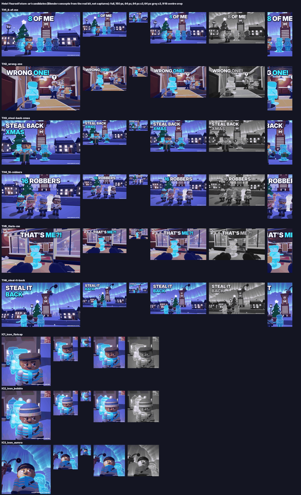

# ICON AND THUMBNAILS: briefs, sketches and exact capture setups

_Marketing kit, file 4 of 5. Written 2026-11-12. Sources: MASTERPLAN §2.2 (brand), §6.2 and §6.5 (palette, clone look), §9.4 (icon, T1-T5, "only 2 active until DAU passes 1,000"); docs/STYLE_BIBLE.md §1-2, §7, §12-13; level data in `src/shared/Levels/` and Config (the capture runs for the icon, T1, T2, T3/F4, T4 and T5 are played through the headless sim by `docs/marketing/clips_check.luau`; revised 2026-11-12 after review: the 0:20 till lock, hats on clones, capture dates); vault *Game Icon Design*, *Thumbnail Composition for High CTR*, *Thumbnail Specs, Rules and Upload*, *Making Thumbnails in Studio and Blender*, *Thumbnail Review Checklist and Scoring Rubric*, *Thumbnail and Icon A-B Testing*; `tools/rbx_search.py` today. Notation: **[DECISION]**, **[UNVERIFIED]**, (H), [estimate] as in the plan._

**Every final image is a real in-game capture** (MASTERPLAN §9.4) from the capture setup in CLIPS.md §3, graded lightly, with text added on top. No paint-overs that change shapes, no characters or loot that the game doesn't have. Alt text and any text a player reads say **flashlight**, not "torch" (most players are American; "torch" stays fine in internal notes and the palette name Torch Amber).

## 0. After the first-person pivot (2026-11-13): read this first

### 0.1 What the top Roblox icons and thumbnails do (2025-2026): 10 rules

Researched 2026-11-13. Sources: the LihFolk vault's top-games snapshot (*Cross-Game Patterns - Thumbnails Icons and Titles That Get Clicks*: the icons and first three thumbnails of ten top games **observed via Roblox's public games and thumbnails APIs on 27 Oct 2026**, plus the *Case Study* notes for Grow a Garden, Steal a Brainrot, 99 Nights in the Forest, Doors, Dead Rails), the vault's *Game Icon Design*, *Thumbnail Composition for High CTR* and *Icon and Thumbnail Rendering Pipeline*, and a web search the same day ([DevForum: Creating a proper Roblox Icon](https://devforum.roblox.com/t/creating-a-proper-roblox-icon-a-guide-based-on-my-preliminary-research/1774810), [DevForum: Optimize CTR with Icons and Thumbnails](https://devforum.roblox.com/t/optimize-ctr-with-icons-and-thumbnails/3316365), [RoWatcher: Your Roblox Game Icon Is Losing You Players](https://rowatcher.com/news/your-roblox-game-icon-is-losing-you-players-before-they-click), [ForgeGUI: Roblox thumbnails that get clicks in 2026](https://forgegui.com/blog/how-to-make-roblox-thumbnail-that-gets-clicks-2026), [Roblox docs: Experience thumbnails](https://create.roblox.com/docs/production/promotion/thumbnails)). This session's network could not open devforum.roblox.com, create.roblox.com or rowatcher.com, so those three are cited from search summaries, not read in full; no live icon images were fetched, so the per-game descriptions are the vault's dated observations. Pressure was not in any source we could reach.

| # | Rule | Evidence | How the finals apply it |
|---|---|---|---|
| 1 | **The icon is a face**, cropped tight, looking at the viewer | 8 of 10 top icons are a face toward the viewer: PS99's cat, Adopt Me's dragon, **99 Nights' deer**, **Doors' entity**, Brookhaven's witch, DTI's doll, Fisch's avatar, **Grow a Garden's farmer** (vault snapshot, 27 Oct 2026); "one big subject, readable expression" (vault *Game Icon Design*) | The Rookie's head and shoulders fill 55-70 % of every icon |
| 2 | **The expression carries the genre** | "Shock or fear (horror), joy (simulator), mischief (troll)" (vault *Game Icon Design*); 99 Nights and Doors use huge eyes / one glowing eye | The smug side-eye (`Rookie_Face_Smug`): mischief, "I got away with it" |
| 3 | **One bright point near the eyes** | "At icon size, eyes are what the visual system finds first"; Doors' monocle, the deer's white eyes (vault Pattern 2) | The Santa cap's Snow trim sits right over the eyes; one gold sparkle near the eye line |
| 4 | **Separate by value first** (grey test), then colour, then a rim light | Subject vs surround ≥ 30-40 points on 0-100 (vault *Composition* §4); "a rim light ... glow around their edges" (web search summary); our own 64 px grades: the blue cap on blue night failed (IC2, 0.06) | Measured: hero and clones ≥ 0.15 grey pop at 64 and 150 px (`final/grades.json`); key + two coloured rims on the hero |
| 5 | **Warm vs cool, saturated subject, calmer background** | "Complementary pair: orange on blue, gold on violet" (vault *Composition* §4); Grow a Garden's gold-on-rainbow, Brainrot's rainbow text | Gold glow and loot against Clone Cyan / Magenta copies on Ink-to-plum; nothing else is cyan |
| 6 | **Simple background: a radial gradient on icons, a blurred scene on thumbnails** | "A radial gradient or flat colour field, with a glow or rim light separating the subject. Busy scenes belong in thumbnails" (vault *Game Icon Design*); "a single saturated colour or a simple gradient reads best" (web search summary) | Icons: a 2D gold-to-plum radial (no set); thumbnails: the real level / town rendered as its own pass and blurred (depth of field) |
| 7 | **A thick dark outline** round the characters | "Outline: dilate the alpha and fill the ring with dark ink. Outlines separate the icon from any card colour" (vault *Rendering Pipeline* stage 4); "a neon outline around a character" (web search summary) | An Ink Indigo outline (1.1 % of the height round the hero) on every character; the clones keep their in-game crew-hue outline plus a glow in their own hue |
| 8 | **Text: none on the icon; ≤ 3 words on a thumbnail**, heavy rounded caps, white with a heavy dark stroke, upper third, away from the bottom edge | "Nobody writes a sentence on an icon" (vault Pattern 2: wordmarks only - Adopt Me, Doors); "white text with a heavy black stroke" (web search summary); the bottom of a tile sits under the player count (vault *Thumbnail Specs*) | No text on icons; thumbnails in **Luckiest Guy** (the game's own display face, `Brand.FACE`) with the Ink stroke and the wordmark's cyan double-exposure copy, cap height 13-15 % of the frame, top third |
| 9 | **Pick the dream: mood art or number art** | The two biggest 2025 games use a giant number (Grow a Garden "$95,643,734,647", Steal a Brainrot "$997,151,167/s"); 99 Nights, Doors, Adopt Me use a creature or a place (vault Pattern 3). Scale contrast sells a creature (Fisch's avatar beside the serpent) | Our number is **8**: "8 OF ME" is our number art; "WRONG ONE!" and "STEAL BACK CHRISTMAS" are mood art (a joke, a place) |
| 10 | **Seasonal art is a costume on the same template** | 9 of 10 top games had Halloween art, but kept their composition and swapped the outfit (Brookhaven, Adopt Me, Doors; vault Pattern 5) | The icons are the evergreen template wearing `Rookie_Cap_Santa`; on Jan 5 the same render with the Flat Cap goes up (`final_shots.py`, `SANTA` -> `DEFAULT`) |

### 0.2 What changed for the store art

- **You are the Rookie, not your Roblox avatar.** The game's own character (`Config.Rookie`: flat cap, long scarf, Breton stripes, knit gloves, smug side-eye; outfits from the wardrobe), and **clones are copies of your Rookie**: the outfit and face kept, the crew pieces in your crew colour, the crew-hue fill and outline, a numbered pill. "That's me" is carried by the outfit, the colour and the pill (PLAN_FIRST_PERSON §1). Every brief below that says "avatar" or "catalog" means this now (§2 "Characters", §3.1).
- **First person is the default.** Your gloves at the bottom of the frame are a new brand asset: they say "this is you" with no text (candidate **TH5**). Third-person stills need Settings → Camera → CLASSIC or the cameraman client (CAPTURE.md §0).
- **Crew View** (hold Q / LB / CREW) is the first-person answer to "where are my clones?": a trailer beat, not a thumbnail.
- **The story exists:** Sir Hoardsworth, his tower with the giant H, the Snow Globe Vault full of the town's presents, the northern lights. Story / event art only; gameplay thumbnails stay inside a heist.
- ~~No Santa hat for the Rookie~~ **`Rookie_Cap_Santa` exists (2026-11-13):** a kit piece in `Rookie_Outfits` (Ribbon cone, Snow trim, pompom; gates pass) and `Config.Rookie.OUTFIT.Cap_Santa`, unlocked by clearing the launch-day advent vault (`Orn_Advent2026_03`, catch-up until Dec 31). The Christmas icon shows it truthfully. Its FBX still has to be re-uploaded (`python3 tools/kit_upload.py --only Rookie_Outfits`, same asset id) before players see it.
- The hook line **"◀ ME, 20 SEC AGO"** still works unchanged (CLIPS.md §1.2): the clone is still "me", now visibly in my outfit.

### 0.3 The 2026-11-13 candidates (Blender, from the real kit; concepts and stand-ins, never uploads)

Rendered by `python3 tools/blender/thumb_shots.py --only <name>` (one image per command), graded by `--sheet` into `thumbs/grades.json` and `thumbs/contact_sheet.png` (each candidate full size, at **150 px and 64 px** (icons square; thumbnails 150 and 64 px tall), 64 px at 3x, 64 px greyscale, and the central 9:16 crop a vertical clip keeps). Every image carries "CONCEPT RENDER, NOT A CAPTURE" in its metadata corner. The real kit: the Rookie (outfits, faces), clones drawn as EchoView draws them, Gus with his Santa hat and cone, the kit loot (cash bag, presents), the van, levels L1 / L2 / L4 rebuilt by `level_shots`, and the story town with Hoardsworth Tower, the Snow Globe Vault and the game's aurora (AuroraPlan).



| Candidate | Brief | Stage | Capturable? | 64 px read (grey pop, `grades.json`) | 150 px read | Score | Honest note |
|---|---|---|---|---|---|---|---|
| [`TH1_8-of-me`](thumbs/TH1_8-of-me.png) | T1 8 OF ME | story town, tower + aurora | the Line-up version (CAPTURE.md C1) | clones +0.13 (just under 0.15), hero a dark silhouette (-0.10), cash bag -0.11 | clones +0.17 | **7.0** | The swarm and the text read at once; the hero is a dark shape against the snow, not a face, and three clones hide behind him. The real Line-up on the level street is the capture |
| [`TH2_wrong-one`](thumbs/TH2_wrong-one.png) | T3 WRONG ONE! | L4 Night Clerk back room (level_shots) | **yes** (CAPTURE.md B3) | clone +0.35, bag +0.16, hero +0.03 | clone +0.40 | **7.5** | The best gameplay joke: Gus in his Santa hat, the "?", the clone in his light. The sneaking Rookie only reads through his gold bag at 64 px; the mop bucket in the foreground is clutter (move the camera half a stud) |
| [`TH3_steal-back-xmas`](thumbs/TH3_steal-back-xmas.png) | T5 STEAL BACK XMAS | story town | no (key art); the DV04 capture brief stays | clones +0.25, hero -0.02, presents -0.18 | clones +0.29 | **6.5** | The face is clear and the presents say Christmas, but the hero merges with the street at 64 px, the Snow Globe is cropped by the text, and 3 words on 2 lines eat the top third |
| [`TH4_16-robbers`](thumbs/TH4_16-robbers.png) | T4 16 ROBBERS | story town | yes (4 clients, CAPTURE.md §4) | clones +0.19, four players dark (-0.15) | clones +0.23 | **7.5** | Four colours, four outfits, 16 bodies: the friends promise reads at 150 px. The Ghost White crew clips to white (as the old concepts warned); the front row is a line, not a hero |
| [`TH5_thats-me`](thumbs/TH5_thats-me.png) | new: the first-person hook | L1 Back Room street, first person | **yes** (CAPTURE.md A6) | clone +0.23, bag -0.04 | clone +0.24 | **7.0** | The only one that shows the pivot (your gloves, the reticle) and the twist in one look. The gloves are the kit stand-ins posed by hand (blocky), the bag is dull at 64 px, the pill "1" is small |
| [`TH6_steal-it-back`](thumbs/TH6_steal-it-back.png) | new: story key art (events) | story town | no (key art) | tower / globe +0.50, clones +0.25, hero -0.25 | +0.55 | **6.0** | A mood piece: the tower under the aurora is the strongest shape, but the crew are three backs at the bottom and the Snow Globe itself sits behind the vacuum. For an E2 event tile, not the Home pool |
| [`IC1_icon_flatcap`](thumbs/IC1_icon_flatcap.png) | icon, evergreen | story town street | key art → illustrator | hero -0.16, copies +0.23 | -0.15 / +0.23 | **6.0** | Face and cap read at 64 px; the copies crowd the left edge and the second hides behind the first; the background is cool and flat (no warm halo) |
| [`IC2_icon_bobble`](thumbs/IC2_icon_bobble.png) | icon, winter | story town street | key art → illustrator | hero -0.06 (fails 0.15), copies +0.24 | -0.06 | **5.5** | The blue Bobble Hat sinks into the blue night: proof that the cap needs a warm halo or a warm colour |
| [`IC3_icon_aurora`](thumbs/IC3_icon_aurora.png) | icon, Christmas night | story town, low angle | key art → illustrator | hero -0.20, copies +0.21, tower +0.53 | -0.22 / +0.20 | **6.5** | The strongest at 64 px: a dark head against the bright aurora, copies to the right. The vacuum's mouth beside his head is noise; the Snow Globe ended up behind the gantry (hence the rename from "globe") |

Trailer key frames (TRAILER.md): [`TR04_first-clone`](trailer/TR04_first-clone.png) **6.5** (the hook reads; the print band itself is left out because a still of it looked like a hat brim), [`TR07_crew-view`](trailer/TR07_crew-view.png) **6.0** (from above the clones are mostly cap tops; the plates' lit cables do the explaining), [`TR09_van-drive`](trailer/TR09_van-drive.png) **7.0** (headlights, the town, the tower and the aurora in one frame).

Scores are honest self-scores on the §7 rubric (0-10, upload bar 8.5): **none of these passes the upload bar, and none is meant to**; they set the direction for the captures and the illustrator. The numbers in the "64 px read" column come from `grades.json` (the hero's / the promise's value pop over its surround at 64 px, in greyscale; ≥ 0.15 reads).

### 0.4 Capture or key art (proposal for the owner: open question 6)

- **Capturable in a heist (keep the "real capture" rule):** TH1 (the Clone Party Line-up), TH2 (L4, CAPTURE.md B3), TH4 (4 clients, CAPTURE.md §4), TH5 (L1 first person, CAPTURE.md A6), T5 via DV04 (CAPTURE.md §5).
- **Key art** (the story town exists only inside the intro): TH3, TH6 and the icons. **Proposal:** allow the **icon** (human-finished, §3.5) and **one** story thumbnail for the events (E1 / E2) as in-engine key art: the game's own meshes, no shape changes, no element the game doesn't have, labelled as key art in our files. Gameplay thumbnails in the Home pool stay real captures.

### 0.6 The finals (2026-11-13): `final/`

The upload set lives in [`final/`](final/UPLOAD.md). It has 3 icons and 4 thumbnails, rendered by `tools/blender/final_shots.py` from the real kit with the §0.1 finish (hero key + coloured rims, the background as a blurred pass, gels, ink outline, clone glow, Luckiest Guy text). Each is graded at 64 and 150 px (`final/grades.json`, `readability.png`, `grid_test.png`).

| File | Score | Use |
|---|---|---|
| `icon_512_1_santa-crew` | 8.8 | Icon Dec 3 - Jan 4; its Flat Cap version from Jan 5 |
| `icon_512_3_santa-twins` | 8.5 | The time-sliced challenger after Jan 5 |
| `icon_512_2_santa-solo` | 8.3 | Below the bar (the hero is only -0.12 grey pop at 150 px); don't upload it |
| `thumb_1920x1080_4_wrong-one` | 8.8 | Home pool at launch (T3) |
| `thumb_1920x1080_3_steal-back-christmas` | 8.7 | Home pool at launch (T5) |
| `thumb_1920x1080_1_8-of-me` | 8.7 | Third Home thumbnail once SwarmSeen ≥ 60 % (T1) |
| `thumb_1920x1080_2_rob-with-clones` | 8.5 | The first-person challenger in the Plays ad test; its text is "ROB WITH CLONES" (≤ 3 words) |

They are key art (§0.4), not captures. The owner decides whether Home thumbnails may be key art. If not, use them as capture targets.

### 0.5 Recommendation for Dec 3

- **Home pool: T5 + T3 as planned**, captured from the TH2 (WRONG ONE) and TH3 / DV04 (STEAL BACK XMAS) targets.
- **Plays test (Dec 3-6): add TH5 "THAT'S ME?!"** as a new creative: it is the only one that shows the first-person game and the core twist in one look, and it is cheap to capture (CAPTURE.md A6). If it wins the ad test, it becomes the third Home thumbnail once DAU allows (§6).
- **Icon:** the illustrator's version of **IC1** (evergreen) with the **IC3** treatment (the aurora and the tower behind him, a dark head on a bright sky: the best 64 px read) for December, unless `Rookie_Cap_Santa` ships.

---

---

## 1. Rules for every image

| Rule | Value | Source |
|---|---|---|
| Thumbnail size | **1920 × 1080**, 16:9 (other ratios are stretched), JPG quality ~90, **under 3 MB** | vault *Thumbnail Specs* (Roblox docs) |
| Icon size | Square, **≥ 512 × 512** (we master at 1024 × 1024); shown as small as ~150 px; **one icon per locale** | same |
| Home pool | 2-5 active for personalisation; **[plan] only 2 active until DAU > 1,000**: launch with **T5 + T3**; add **T1** once SwarmSeen ≥ 60 % by minute 10 is confirmed | MASTERPLAN §9.4; growth.md F1 |
| Video thumbnail | Real gameplay only, varied angles OK, no narration, no voice, no music with lyrics, sparing gameplay-only text; **3 uploads a month, rejections included** | vault *Thumbnail Specs* §4 |
| Truth gate (G1) | Every character, item, place, effect, number and UI element exists in the game; same art style | vault *Thumbnail Review Checklist* |
| Policy gate (G2) | No handles, links, QR codes; no Robux, "FREE", discounts, "UPDATE", "x2"; fits the Mild label; no other game's characters or branding; no heist masks | same; MASTERPLAN §1.3 |
| Text | **≤ 3 words**, upper third, cap height **≥ 90-110 px** at 1080p, outline 6-10 px in the darkest value | MASTERPLAN §9.4; vault *Composition* §6 |
| Focal subject | One hero at **30-45 % of the frame**, face on a rule-of-thirds point, looking into the frame or at the viewer | vault *Composition* §2 |
| Three-element limit | Hero + the promise (secondary) + text. Everything else is background | vault *Composition* §5 |
| Upload bar | Score **≥ 8.5 / 10** on the rubric (§7), both gates passed | vault *Review Checklist* |

### 1.1 Safe areas (16:9, 1920 × 1080)

```
+--------------------------------------------------------------------+
|[c]  corner 5 % (96 x 54 px): nothing essential               [c]   |
|     TEXT ZONE: upper third (y 54-360)                              |
|                                                                    |
|   . . . . . . . . . . . . . . . . . . . . . . . . . . . . . . .    |
|   .  ALL THREE ELEMENTS live in the centre 80 % x 70 %        .    |
|   .  (x 192-1728, y 162-918)                                  .    |
|   .  hero face on a thirds point: (640, 360) or (1280, 360)   .    |
|   . . . . . . . . . . . . . . . . . . . . . . . . . . . . . . .    |
|- - - - - - - - - - - - - - - - - - - - - - - - - - - - - - - - - - | y 886
|     BOTTOM 18 %: player counts and metadata cover it. Nothing     |
|[c]  essential here.                                          [c]   |
+--------------------------------------------------------------------+
```

Make this a guide layer in the image editor (and, once the owner kit has it, a toggle in the capture place).

---

## 2. Brand constants for all art

| Element | Value |
|---|---|
| Ground / background | Ink Indigo `#1C1F3B` (never darker), Plum Slate `#3A3560` |
| **Clones** (the brand colour) | Clone Cyan `#3DE8FF` for the solo / P1 crew; Magenta `#FF4FD8`, Indigo `#6A5CFF`, Ghost White `#F4F7FF` only when other players' crews are in the shot. **Nothing else in the frame glows cyan** (STYLE_BIBLE §1.2-1.3) |
| Age ramp | As the game draws it: each older clone 12 % dimmer, older solo clones drift up to 25° toward violet. Capture it; don't recolour it |
| Loot | Heist Gold `#FFC21F` with a **sparkle** shape; always on a dark surface (gold vanishes on Warm Marble, STYLE_BIBLE §1.3) |
| Guard light | Torch Amber `#FFD27A`, only as Gus's cone |
| Danger | Alarm Red `#FF3838` (owner-confirmed 2026-11-12, STYLE_BIBLE §1.1) only as real alarm beacons and lasers, always with a shape; never decoration, never text |
| Christmas | Holly Green `#2FBF71`, Ribbon Burgundy `#8C2F4B` (Santa hats, berries), Snow `#C0C3D5` (small areas), warm-white fairy lights `#FFE7B8` |
| Characters | **The Rookie** (revised 2026-11-13): the game's own player character, not a catalog avatar (`server/Heist/Characters`, `Config.Rookie`): chunky, big head, Breton sweater, flat cap, long scarf, knit gloves, smug side-eye (faces idle / smug / shocked / busted). Brand shots use the **default outfit** (Flat Cap, Long Scarf, Breton Stripes, Knit Gloves) in **seat 1 = Clone Cyan** crew pieces. **Clones are copies of your Rookie** (`Avatars.buildRookie`): the outfit and the face are kept, only the crew pieces (scarf, stripes) take the crew hue, then the crew-hue fill (0.55) + outline, a floor glow and a numbered pill; older solo runs dimmer and drifting violet. So the copies now show the face, the cap and the scarf under the cyan fill (the old "smooth cyan heads" are gone). **Gus**: big flashlight (the "torch" of the internal docs), peaked cap, handlebar moustache, Santa hat Dec 3 - Jan 4 (STYLE_BIBLE §12). **Sir Hoardsworth** now exists (the story intro, `Hoardsworth` kit rig): use him only in story / event art, never in a gameplay thumbnail (he is not in a heist) |
| Text style | **[DECISION]** Heavy rounded caps in a free-licensed font (proposal: *Lilita One*, SIL Open Font License; the owner or the freelance artist may pick another OFL or owned font that matches the "HEIST YOURSELF" wordmark). Fill Getaway White `#F4F7FF`, outline Ink Indigo `#1C1F3B` 8-10 px, the key word in Clone Cyan |
| Never | Heist masks, guns, police, money piles with "$$$", Robux icons, emoji stickers, arrows, other games' looks, AI-generated art (MASTERPLAN §1.3, STYLE_BIBLE §9) |

**Standing apart from the heist row (checked today with `tools/rbx_search.py`):** the current heist and steal titles lean on money and gem emoji (💰 💎 🏦) and city / police framing (Criminal Simulator, ROB IT, Heist Evolution, Risky Heist, HEIST: Rob a Store); the clone games (Clone Engine, Clone Friends) are bright sandboxes. Our difference is **a face plus glowing cyan copies of the same character at night**: nobody in either row shows "many of me" in a heist. We couldn't load the competitors' icon images from this session (the image CDN was blocked), so the owner does the row test in §7 with real screenshots.

---

## 3. Icon brief

**Concept:** the Rookie's face (no mask), smug side-eye at the viewer, with **two cyan copies of the same head fanned out behind him**, on Ink Indigo with the warm glow of the vault dial behind his head, one gold glint, **no text**. Santa hat from Dec 3 to Jan 4 (MASTERPLAN §9.4).

### 3.1 Composition (1024 × 1024 master)

```
+--------------------------------+
|                                |
|    c2      c1                  |   c1, c2 = cyan copies of the head,
|   (  )   (  )   .--------.     |   offset ~8 % of the width each,
|    ''     ''   ( Santa hat)    |   up and to the left, older = dimmer
|        . o O(  -  o  )O o .    |   halo = vault dial ring glow (warm)
|       (    ( smug  side )   )  |   behind the head, partly cropped
|        ' o  (   eye     ) o '  |
|              \  ~~~  /    *    |   * = gold glint (bar edge), near
|           ____\_____/____      |       the eye line, <= 4 % of area
|          /  scarf   scarf \    |
|         /                   \  |   subject (head + copies + shoulders)
|________/_____________________\_|   = 60-80 % of the frame; shoulders
+--------------------------------+   break the bottom edge
```

| Item | Spec |
|---|---|
| Subject | Head and shoulders of the Rookie, **60-80 % of the frame**, face in the upper-middle (eyes ~38-42 % from the top), turned 3/4 toward the viewer, eyes to the viewer (side-eye smirk) |
| The twist | **2 cyan copies** (not 3: at 64 px a third becomes noise) of the same head, up-left and a little smaller (they stand behind), the in-game clone look (the Rookie under the crew-hue fill + outline) with the age ramp. Since the pivot the copies keep the face and the cap, so the read is "the same guy, glowing" rather than "ghosts"; offsets of ~19 % and ~36 % of the width keep both readable (the 2026-11-12 concept notes; at 8 % they hide behind his head) |
| Background | Ink Indigo field, a soft Plum Slate radial behind the head, the **vault dial ring** (in-game Neon, Warm Marble `#D8C8A8` glow) as a halo partly behind the head |
| Accent | One Heist Gold glint: the loot he holds at shoulder height (every loot item carries the gold sparkle shape, STYLE_BIBLE §1), with the sparkle near the eye line on the right. If no loot can be in his hand in the capture, leave the glint out: never paint one in |
| Christmas (Dec 3 - Jan 4) | **Revised 2026-11-13: there is no catalog avatar any more, and the Rookie has no Santa hat** (the cap slot is Flat / Beanie / Bobble / Trapper; `Hat_Santa` is a clone cosmetic of the pre-Rookie rig, **[UNVERIFIED]** whether it still dresses Rookie clones). Options, in order: (1) **request a `Rookie_Cap_Santa` cap piece** (art track: Ribbon Burgundy with a snow trim, the Bobble's attach point; the trim carries the 64 px read, Ribbon Burgundy alone is only 0.14 luma above Ink Indigo) and a Christmas outfit unlock; (2) the illustrator draws the Santa cap on the human-finished icon (§3.5) **only if (1) ships**, or the icon shows something the game doesn't have; (3) fallback: the Christmas icon uses the **night-sky treatment** of `IC3` (the aurora and Hoardsworth Tower over his head; the Snow Globe glow if the illustrator can place it clear of the head) and keeps the flat cap |
| Evergreen (from Tue Jan 5) | Same capture without the hat (shoot both versions in the same session) |
| Text | None (vault: text at icon size is noise; one icon per locale, so text-free works for Danish too) |

### 3.2 Pass criteria (before upload)

- [ ] **64 px greyscale:** the face, the two copies and the background are three separate values. Numbers: copies (cyan luma 0.77) vs background (0.13-0.22) ≥ 0.15; face vs background ≥ 0.15 (depends on the avatar's skin tone: if it fails, the warm halo goes directly behind the face).
- [ ] Viewed at **150, 100, 64 and 48 px** on a real phone (light and dark app theme), with the vault's icon-test snippet in Studio (*Game Icon Design*, "Test at real sizes").
- [ ] Nothing important in the corners; no thin details (scarf fringe, hair strands) carrying the read.
- [ ] **Row test:** pasted into a row of screenshots of the current top results for `heist` and `clone` at the same size: the eye lands on ours, and ours is the only "copies of a face".
- [ ] **Stranger test:** shown for 2 s to someone who hasn't seen the game: "what do you think this game is about?" Good: "robber / clones / copies of himself". Bad: "ghost game", "puzzle".
- [ ] Owner (style owner) signs it off at 64 px (MASTERPLAN §10.3 #10).

### 3.3 Exact capture setup (icon)

| Step | Do |
|---|---|
| Where | **L6 The Big Score: Bank**, the scale room, facing the **vault door** (door plane at z -48). The dial is on the door face, 3.6 studs above the floor (STYLE_BIBLE §7 anchor T) |
| Outfit (revised 2026-11-13) | Your Rookie in the default outfit (Flat Cap, Long Scarf, Breton Stripes, Knit Gloves), seat 1; the face is the game's (smug shows on a bank, `Config.Rookie` faces), so time the frame to a bank or use the idle face. The copies wear the same outfit under the cyan fill. Christmas version: §3.1 row "Christmas" |
| Camera mode | In-game **Settings → Camera → CLASSIC** before the run, then the freecam while you stand on the hero mark (CAPTURE.md §0) |
| Clones | The vault door must stay **closed** (the dial is on it), so the path is lobby → staff door → hall → laser grid → scale room. Wait for every crossing beside the staff door in the lobby (x -4, z -11), out of Gus's sight. **Run 1:** stand on plate A (behind the teller desk, through the counter gate; holds the staff door), END there. **Run 2:** at **0:05.3** go through the staff door to plate B (under the fern, just inside on the west; turns the hall grid off), END there. **Run 3 (copy 2):** at **0:06.0** cross the hall and the (now dark) grid into the scale room and stand at (x -2.4, z -44.5): 2.4 studs left of the dial's centre line and 1 stud closer to the door than the hero mark; face +z (toward the arch), END at about 0:14. **Run 4 (copy 1):** the same to (x -1.2, z -44.0), END. **Run 5 (hero):** grab the lobby drawer cash (x 12, z -9, through the counter gate: its sparkle is the gold glint), wait beside the staff door, cross at **0:06.0**, stand on the hero mark (x 0, z -43.5: the dial's centre line, 4.5 studs in front of the door), face +z, then the freecam (you stand still). Crossing windows from beside the staff door (sim): **5.2-7.8 s**, then about every 9 s (9.4-16.8 s); a crossing outside them is caught. Gus paces the hall, not the scale room, so the room is quiet. Run budget: Dawn at run 8, the heist only completes on the gold: never touch it |
| Camera (`CAM_ICON`) | Freecam 6 studs in front of the hero's face, **at chin height**, pitched up 3-5° so the dial ring sits behind the head; FOV **30**; the head + two copies fill the centre square |
| Lighting | The project's "Heist Night" as shipped; no extra lights (truth rule). A light DepthOfField is allowed (the game uses it in menus and the reel): focus on the face, far intensity ~0.3 |
| HUD | Off (CLIPS.md §3.2) |
| Capture | Record a few seconds at the highest resolution (2560 × 1440 or more) and grab the best frame; crop a square around the subject; downscale to 1024 × 1024 |
| Finish | Levels (hero above mid-grey), 10-20 % vignette, light sharpen after downscale. No shape changes, no added glow beyond what the game shows |
| Files | `docs/marketing/art/YYYY-MM-DD_icon_xmas_v1.png` and `_evergreen_v1.png`, with the camera CFrame and FOV in a `.txt` next to them |

### 3.4 Icon schedule

- Draft from the golden room by **Fri Nov 27**, owner sign-off by **Mon Nov 30**, uploaded (private) by **Wed Dec 2**. The full capture calendar for the icon and T1-T5 is in §4.0.
- Christmas version live **Thu Dec 3** → evergreen version **Tue Jan 5**.
- No other icon changes in December. An icon change is a **time-sliced** test (14 days A, 14 days B, only trust a 30 %+ difference, not in update weeks, not during a thumbnail round; vault *A-B Testing* §5). Keep a dated archive with the metric window of each version.

### 3.5 Illustrator brief: the human-finished icon (new 2026-11-13)

MASTERPLAN §2.2 wants the mascot **human-finished** (an AI provenance log for any moodboard use). The Blender candidates `thumbs/IC1_icon_flatcap.png`, `IC2_icon_bobble.png`, `IC3_icon_aurora.png` are **stand-ins and references for this brief, never the upload**. Send the illustrator this section, the three candidates, `docs/art/rookie_sheet.png` (the Rookie's outfits, faces and four crew colours), `docs/art/turntables/Rookie*.png` and `docs/art/intro/shot_6.png` / `shot_7.png` (the Rookie and his clones lit).

| Item | Brief |
|---|---|
| Deliverable | A **1024 × 1024** icon (PNG, layered source: PSD / Krita / Procreate), plus a **Christmas variant** (same art, the seasonal change only). Rights assigned in writing (MASTERPLAN §1.3: original, commissioned). No AI-generated pixels in the deliverable |
| Subject | **The Rookie's head and shoulders** exactly as the game models him (the kit is the model sheet: big head, flat cap, long scarf, Breton stripes, smug side-eye with one brow cocked and the crooked smirk). Eyes ~40 % from the top, turned 3/4, eyes to the viewer. Head + shoulders 60-80 % of the frame |
| The twist | **Two copies of him**, up and to the left, smaller (behind), in the **clone look**: the same Rookie under a flat Clone Cyan `#3DE8FF` glow with a bright cyan outline; the older (further) one dimmer and drifting toward violet (the age ramp). They keep his face and cap (that is the game since the pivot). Not three: at 64 px a third is noise |
| Background | Ink Indigo `#1C1F3B` night with a soft warm halo behind the head: the **aurora and Hoardsworth Tower** over him (IC3), the Snow Globe Vault's glow, or a street lamp (IC1/IC2); a hint of the aurora's green-teal in the top corner at most (STYLE_BIBLE §16: never cyan, it must not compete with the copies) |
| Accent | One Heist Gold `#FFC21F` glint only if he holds loot (a cash bag at the shoulder); else none |
| Christmas variant | Only what the game will really have on Dec 3: if the art track ships a `Rookie_Cap_Santa` (§3.1 "Christmas"), the Santa cap on him and the copies; if not, the IC3 night sky (aurora, the tower, the Snow Globe if it sits clear of the head) with snow falling, and the flat cap stays |
| Style | The game's chunky low-poly toy look, flat-shaded planes, bold silhouette, no outlines on the hero except where the game draws them (the copies' outline). Readable in **greyscale at 64 px**: hero face, copies and background are three separate values (§3.2) |
| Never | A mask, a weapon, money piles or "$$$", Robux icons, text, arrows, emoji, other games' characters or looks, a Roblox avatar, Gus or Hoardsworth (they are for thumbnails and events) |
| Process | 2 rough sketches (Mon Nov 23) → owner picks one → colour draft at 64 / 150 px on a phone (Thu Nov 26) → final by **Fri Nov 27** (the §3.4 slot) → owner sign-off Mon Nov 30 → upload Wed Dec 2 |
| What the candidates teach (from the grades, §0.3) | The face carries the icon at 64 px in all three; a **bright field behind the head** (IC3's aurora: grey pop 0.20) is what separates the dark cap from the night, while a blue cap on blue night fails (IC2: 0.06); the copies must sit clear of his cap and of the frame edge (in IC1/IC2 they crowd the left edge and the second hides); keep props (IC3's vacuum) away from the head |

---

## 4. Thumbnail briefs T1-T5

**First-person build (2026-11-13):** wherever a brief below says "freecam" or "pinned", read CAPTURE.md §0: Settings → Camera → CLASSIC for freecam stills, or the **cameraman client** for a fixed angle while the live you moves; "avatar" means your Rookie in the default outfit. The positions and timings are unchanged (the sim did not change; `clips_check.luau` still holds them). The Blender target frame for each brief is in §0.3.

Each brief: the promise, the sketch (64 × 16 characters ≈ 16:9; `·` = corners, the dashed line = top of the bottom 18 %), what it tests, and the exact capture setup. Times are elapsed run time; positions are level coordinates (CLIPS.md §4 explains them and the run budget). A still where the hero stands on a mark can use the freecam; a still where the hero walks needs the pinned camera (CLIPS.md §3.2 #4) or a 60 fps recording of the follow camera.

### 4.0 Capture calendar (everything the Dec 3-6 Plays test needs is shot by Sun Nov 29)

| Image | Session | Date | Needs | Feeds |
|---|---|---|---|---|
| Icon (both versions) | own session | **Fri Nov 27** | L6 | sign-off Nov 30, upload Dec 2 |
| T3 | own session (same day) | **Fri Nov 27** | L4 (Christmas-dressed version again on Dec 1) | Home pool + Plays test |
| T5 v1 | own session | **Fri Nov 27**, or **Tue Dec 1** (C4) if the dressing isn't visible in Studio yet | DV04 on demand (or the L4 fallback), dressing layer | Home pool + Plays test |
| T1, T2 | **C3** (CLIPS.md §7) | **Fri Nov 27** | L5 Clone Party, the same set-up as F2-B | Plays test |
| T4 | 4 **test accounts** in one party | **by Sun Nov 29** **[UNVERIFIED: that 4 local Studio test clients can form one party; try it on Nov 27]** | L5, 4 clients | Plays test, if shot in time |
| T4 (fallback) | **C5 friend session** | Dec 4-5 | 3 friends + permissions (LAUNCH_CHECKLIST appendix B) | **not** in the first Plays test; joins the next ad round and the Home pool later |

Ad creatives are uploaded on **Mon Nov 30** (LAUNCH_CHECKLIST) for the Dec 3-6 Plays test, so anything not shot by Nov 29 sits that test out.

### T1 "8 OF ME": the swarm promise

```
+----------------------------------------------------------------+
|·                                                              ·|
|                                  ##  8 OF ME  ##               |
|                                                                |
|         ___                  c        c        c   (lit toy    |
|        /cap\                   c      c      c      aisles)    |
|       ( -o  )  smug              c    c    c                   |
|        \___/                       c     c                     |
|      __/scarf\__   *$                 V of 7 clones, each      |
|     |  HERO    |--[bag]               holding stolen toys,     |
|     |  (live)  |                      smaller toward the back  |
|     |          |                                                |
|- - - - - - - - - - - - - - - - - - - - - - - - - - - - - - - - |
|      (floor, soft)                                             |
|·                                                              ·|
+----------------------------------------------------------------+
```

| Item | Spec |
|---|---|
| Promise | "Solo, there can be 8 of you." The game's own **"8 OF ME"** stamp (Clone Party run 8) is the text, so it is real UI text |
| Hero | The live Rookie at the **left third**, waist up, ~35 % of the frame, smug, holding the till's cash bag with a gold sparkle |
| Secondary | 7 cyan clones in a V receding to the right, each holding a toy, candy or teddy; the lit aisles behind |
| Text | `8 OF ME` upper right ("8" in Clone Cyan) |
| Tests | **The swarm promise.** Hypothesis: "copies of one robber" beats the seasonal promise (T5) for new players once the first session delivers it. Variable vs T5: subject (swarm vs Christmas). **Gate:** goes into the Home pool only after SwarmSeen ≥ 60 % by minute 10 (analytics); before that it runs in the Plays ad test only |
| **[DECISION] Location** | MASTERPLAN §9.4 says "hero with gold, vault light". In the Big Score, 4 of the 7 clones must stay on the 4 vault plates (2 of them out of sight in the lobby and hall), so only 5 copies could be in frame. **Clone Party** shows all 8 and is where "8 OF ME" really happens (the party break right after L2: about minute 11 of a first session at the plan's midpoint, 8-14 across its band; `tests/sim/Pacing.spec.luau`). A Bank variant (T1-B: 8 of you at the Crew Line-up by the van after the Big Score) is a later single-variable test |

**Capture setup T1**

| Step | Do |
|---|---|
| Level | **L5 Clone Party**, solo, Rookie, HUD off |
| Runs 1-7 | Each run: grab one item from a different shelf (front rows z -8 candy, mid z -14 toys, back z -20 teddies), bank nothing, walk to your V mark in the shop's front area and END there (by about 0:12) **holding the item, facing the entrance (+z)**. V marks (x, z): `(-2.5, 0)`, `(2.5, 0)`, `(-5, -2.5)`, `(5, -2.5)`, `(-7.5, -5)`, `(7.5, -5)`, and the 7th centred behind at `(0, -4)`. The apex (hero) is `(0, 3)` |
| Run 8 | "8 OF ME" stamps in at 0:01.5. Walk to the till (x -8.5, z -1) with **empty hands** and wait: it is **time-locked until 0:20** (`Config.Levels.PARTY_TILL_OPENS_SECONDS`; an earlier grab is refused). Grab it at 0:20: the alarm starts (red beacons; Gus wakes in the back office and comes up the aisles: about halfway, near x -3, z -17, at 0:21.5 in the sim). Walk to the apex `(0, 3)` (about 0.6 s), face the camera. Capture between about **0:20.6 and 0:21.8**, while Gus is still in the aisles |
| Run budget | Clone Party: Dawn after run 8, all 8 runs needed, so one image set per heist (~5 min) |
| Camera (`CAM_T1`) | Freecam 10 studs in front of the apex (z ≈ 13, by the door), 1.5 studs to the right, at 4.5 studs height, FOV **40**: the hero's face on the left-third line ~35 % from the top, the V spreading back to the right |
| Capture | 60 fps recording at the highest resolution; pick the frame where the hero's face is clear and the beacons are at the edges, not on a face |
| Takes | 3 distances (8, 10, 12 studs): dolly the freecam from 12 to 8 studs during the 0:20.6-0:21.8 window and pick frames, or one distance per heist. Without the alarm beacons: a separate heist where the hero holds a shelf item instead of the till cash. That is the next test round (vault *Making Thumbnails* §5) |
| Alt text | `Eight copies of the same robber, seven of them glowing clones, stealing toys from a shop at night.` |

### T2 "BETRAYED!": the clone-betrayal emotion

```
+----------------------------------------------------------------+
|·                                                              ·|
|    ##  BETRAYED!  ##                                           |
|                                                                |
|   (red beacon)                            .-----.              |
|        c  <- clone at the till,          ( O  O )  shocked     |
|       /|\    cash in hand                 ( 'o' )  face, lit   |
|      [till]                      GUS    __/scarf\__ in amber   |
|                                 (torch)>>>>>>  HERO   |        |
|                                  small,   |  (live)   |        |
|                                  behind   |           |        |
|                                           |           |        |
|- - - - - - - - - - - - - - - - - - - - - - - - - - - - - - - - |
|                                                                |
|·                                                              ·|
+----------------------------------------------------------------+
```

| Item | Spec |
|---|---|
| Promise | "Your own clone can ruin your plan" (Mistakes are content, pillar 2) |
| Hero | The live Rookie at the **right third**, ~35 %, with the game's **shocked face** (`Rookie_Face_Shocked`, shown on a zap; for a still, time the frame to a face swap or use the idle face), lit by Gus's amber flashlight cone |
| Secondary | A cyan clone at the till, cash bag in hand, under the red alarm beacon (left third, mid-ground); Gus small behind the hero in the aisle |
| Text | `BETRAYED!` upper left |
| Tests | **Emotion + betrayal.** Hypothesis: a shocked face + "my clone did it" beats the calm comedy of T3. Variable vs T3: the emotion and who the threat is. Runs in the Plays ad test first; enters the Home pool when the pool can hold 3+ |
| **[DECISION] Truth** | The plan's "a clone pressing the alarm": the game has no alarm button. What trips the alarm is **grabbing the top loot**, so the clone is shown robbing the till under the beacons |

**Capture setup T2**

| Step | Do |
|---|---|
| Level | **L5 Clone Party**, solo, HUD off, shocked face on the Rookie |
| Run 1 (traitor) | As CLIPS.md F2-B: rob one shelf item and **bank it** (the till needs empty hands at bag level 0), be at the till before 0:20, **grab it at about 0:20.5** (it is time-locked until 0:20), stay next to the till facing into the shop, END at about 0:22 |
| Run 2 (hero) | By 0:20 stand at the front end of the east aisle (x 4, z -6) facing the shop entrance. At 0:20.5 the alarm trips (your clone). Gus comes out of the office and straight up the aisle toward the nearest robber he can see (sim: he chases you from 0:20.6 and catches you at about 0:22.4). Stay put so he picks you; if a take misses, Undo and play run 2 again (each take costs a run; Dawn at run 8 leaves 6). In C3 this is run 4 of the F2-B heist (after its two takes) |
| Camera (`CAM_T2`) | Freecam near the door on the east side (x 6, z 4), height 3.5, looking back into the shop (toward x -2, z -10), FOV **45**: hero at the right third, the till and clone at the left third, Gus small in the aisle behind the hero |
| Moment | Gus 6-14 studs behind the hero in the aisle, his cone on the hero: about **0:21.5-0:22.2** (sim); his "!" pop above him is fine (real UI) |
| Alt text | `A robber lit by a guard's flashlight looks shocked as his own glowing clone robs the till and sets off the alarm.` |

### T3 "WRONG ONE!": the guard comedy (launch, Home pool)

```
+----------------------------------------------------------------+
|·                                                              ·|
|   ##  WRONG ONE!  ##                        (?)                 |
|                                          .------.              |
|                                         ( GUS   )  double-take |
|                                          \ o_O /   face        |
|     .--.                         c  <<<<<<<|=|  torch (amber)  |
|    (-o  )  smug, tiptoe          /|\ busted |  |  on the clone  |
|    /|bag|\  (left third,         / \ clone, |__|               |
|     /   \   mid-ground)             glitching  big, right      |
|  safe-room door behind                          third, ~35 %   |
|                                                                |
|- - - - - - - - - - - - - - - - - - - - - - - - - - - - - - - - |
|                                                                |
|·                                                              ·|
+----------------------------------------------------------------+
```

| Item | Spec |
|---|---|
| Promise | "The guard catches your clone while the real you gets away" (the threat with a face + clones as decoys) |
| Hero | **Gus** at the **right third**, ~35 %, frozen in his real 2.0 s "huh?" double-take, the "huh?" bubble above (in-game UI), flashlight cone on the clone he just busted |
| Secondary | The busted cyan clone in the cone (centre), flickering into tape ribbons, and the live Rookie at the left third, smaller, stepping out of the safe-room door with the night-deposit bag, smug |
| Text | `WRONG ONE!` upper left |
| Tests | **The guard comedy** vs the seasonal T5 (the launch pair). Variable vs T5: Gus + decoy joke vs Christmas. This is the plan's "Gus as a character" positioning (§9.1) |
| **[DECISION] Truth** | MASTERPLAN §9.4 says "Gus holding a clone by the collar" and "the diamond". The game has no collar grab (Gus freezes with "?" and the clone glitches into tape ribbons) and **no diamond in the six launch levels** (loot is cash, toys, gold and presents). So: the real double-take pose, and the hero carries L4's **night-deposit bag**. If a diamond is added to a level later, a T3 variant with it becomes a single-variable test |

**Capture setup T3**

| Step | Do |
|---|---|
| Level | **L4 Night Clerk** (Christmas-dressed version from Dec 1: Gus wears the Santa hat; shoot both) |
| Runs 1-3 | Exactly CLIPS.md §4.4 (F4): run 1 holds plate A (back-room door), run 2 hides on plate B under the coat rack (safe-room door), run 3 is the decoy standing at (x 2, z -24), caught at about 0:18.6 when Gus turns west and walks toward it |
| Run 4 (hero) | As F4's hero: cross at 0:06.6 while Gus faces the till, grab the night deposit (x 0, z -42) and wait just inside the safe room (x 1.5, z -39). When Gus busts clone 3 (about 0:18.6) he freezes at about (x 9, z -28) facing the spot where it stood (west-north-west), vision paused: step out of the safe-room door (z -36) with the bag and walk north past him. The same heist gives F4's takes (runs 4-6, Dawn after run 6) |
| Camera (`CAM_T3`) | **Pinned** (the hero walks; CLIPS.md §3.2 #4), on Gus's line of sight so his face points at the lens: low (2.5 studs) in the back room's west part, about (x -6, z -31), looking toward his freeze spot (x 9, z -28), FOV **45-50**: Gus at the right third, the clone in his cone in the centre, the safe-room door at the left edge. Check the framing once with the freecam before you pin it |
| Moment | 0.15-0.35 s after the bust (about 0:18.75-0:18.95): the clone still flickering in its tape burst (it is gone 0.35 s after the bust), "huh?" up, the hero in the safe-room doorway with the bag. Record 60 fps and pick the frame |
| Alt text | `A night guard with a big flashlight stares at a glowing clone he just caught, while the real robber sneaks past him with a bag of cash.` |

### T4 "16 ROBBERS": the friends promise

```
+----------------------------------------------------------------+
|·                                                              ·|
|                       ##  16 ROBBERS  ##                       |
|                                                                |
|                m  m  i  i  w  w  c  c  m  i  w                 |
|     .--.     m  M  i  I  w  W  c  m  i  w   (4 colour crews,  |
|    (-o  )     m  i  w  c  m  i  w            synchronized     |
|   __/  \__      ..one mass, same pose..       victory pose)   |
|  |  OWNER |                                                    |
|  | (cyan  |          [ VAN ]                                   |
|  |  crew) |                                                    |
|  |        |                                                    |
|- - - - - - - - - - - - - - - - - - - - - - - - - - - - - - - - |
|                                                                |
|·                                                              ·|
+----------------------------------------------------------------+
   c = Clone Cyan (owner), m = Magenta, i = Indigo, w = Ghost White;
   capitals = the 3 friends (live), lower case = clones
```

| Item | Spec |
|---|---|
| Promise | "With friends, 16 robbers in one heist" (pillar 5; the thing jams and Rewind Robbers can't do, §9.1) |
| Hero | The owner's Rookie at the **left third**, ~30-35 %, at the front of the line-up |
| Secondary | The other 15 as **one mass** in 4 hues with their glyph badges (●1 ■2 ▲3 ◆4), all in the same synchronized pose. The vault rule "no five-character line-ups" is about separate characters; here the crowd reads as one shape |
| Text | `16 ROBBERS` upper centre |
| Tests | **The social promise.** Hypothesis: "16 robbers with friends" pulls friend groups (sessions with a friend ≥ 20 % KPI). Variable vs T1: one player's swarm vs four players' crowd. Plays ad test first; Home pool when it has 4-5 slots |
| **[DECISION] Moment** | The **Crew Line-up** (every clone of every crew member + the players walk to the van and strike one synchronized pose, MASTERPLAN §3.2 #8): it exists in every heist, so the shot is always reproducible and every one of the 16 is in frame (in the Big Score's vault, 4 clones would be stuck on plates out of shot) |

**Capture setup T4**

| Step | Do |
|---|---|
| People | Owner + 3 friends with written permission (LAUNCH_CHECKLIST appendix B); or 4 test accounts. If friends use their own avatars, that's fine with their OK; name tags off on every client (CLIPS.md §3.2) |
| Level | **L5 Clone Party** with a party of 4 (cap per player `floor(12 / 4) = 3`, so 4 players + 12 clones = 16), or L6. Run budget: Dawn is **run 8**, so every player plays 8 runs (any jobs; END early to save time): runs 1-3 fill each deck, runs 4-8 each replace that player's newest clone, so the count stays 3 each (sim: run 8 has 16 robbers). The heist then ends into the Crew Line-up (~4-5 min in all) |
| Camera (`CAM_T4`) | Low (2.5 studs) on the street about 12 studs in front of the Line-up (it stands at z 28, facing the street, so the camera is at about z 40 looking back at the shop), FOV **50**, the owner front-left, the crowd and the van behind |
| Moment | The apex of the victory pose (60 ms stagger per clone in record order, so wait until the last clone hits it) |
| Alt text | `Four friends and twelve of their glowing clones, sixteen robbers in four colours, pose together in front of their getaway van.` (shot with 4 test accounts: `Four players and twelve of their glowing clones, ...`) |
| When | By Sun Nov 29 with 4 test accounts if that works, else the Dec 4-5 friend session: then T4 is not in the first Plays test (§4.0, §6) |

### T5 "STEAL BACK XMAS": the seasonal promise (launch control)

```
+----------------------------------------------------------------+
|·    (fairy lights, warm white)                                ·|
|                                       ##  STEAL BACK XMAS  ##  |
|                                                                |
|       .--.             |  back-room   |                        |
|      (Santa)   smug     |  doorway     |   (garland / lights   |
|      ( -o  )            |  GUS (Santa  |    on the front-room  |
|    __/scarf\__   c  <- clone  hat), small, facing   walls)     |
|   |  HERO   [PRESENT]  /|\[gift]  the east wall                |
|   | (live)  |  big,     / \                                   |
|   |         |  ribbon                                          |
|   |         |                                                  |
|- - - - - - - - - - - - - - - - - - - - - - - - - - - - - - - - |
|   (garland, snow cap on the counter)                           |
|·                                                              ·|
+----------------------------------------------------------------+
```

| Item | Spec |
|---|---|
| Promise | "Steal the presents back: a Christmas heist with your clones" (§4.3) |
| Hero | Your Rookie (default outfit; a `Rookie_Cap_Santa` only if the art track ships one, §3.1 "Christmas"), left third, ~35 %, carrying the big wrapped present toward the camera at belly height |
| Secondary | A cyan clone right behind him with the second present (its silhouette wears the hat too); through the doorway, Gus in his Santa hat small in the back room, facing the other way; the dressing layer's garland and warm-white lights on the front-room walls if the layer puts them there. **No tree in this shot:** DV04's tree hide (x -15.5..-10.5, z -26.5..-21.5) is behind the z -20 wall, out of view through the 6-stud doorway (a back-room angle would show it but puts Gus right by the camera) |
| Text | `STEAL BACK XMAS` upper right (3 words, "XMAS" in Clone Cyan) |
| Tests | **The control at launch** (the event promise). Hypothesis: the seasonal promise wins Dec 3 - Jan 4 for new players. It is the baseline every other thumbnail is compared with |
| **[DECISION] v1 vs v2** | **v1 (Dec 3)** shows only launch content: a Christmas daily vault, presents, the dressing layer, Gus in a Santa hat. The growth report's "Snow Globe Vault cracked open, Sir Hoardsworth furious" is the finale (Dec 18) and Hoardsworth has no model yet, so that is **v2**, shot from the finale build once it exists, and swapped in on Dec 18 as a single change |

**Capture setup T5 (v1)**

| Step | Do |
|---|---|
| Level | **Daily vault 4 "Mistletoe Patrol"** (`DV04`): one plate (A, x 10, z -8) holds the back-room door, Gus paces the back room, a Christmas tree to hide behind, the big **Present** at (0, -34) and the **Ribbon** present at (-12, -34). Needs the capture build to load DV04 on demand (owner kit item 1; otherwise it is the daily vault only on its advent date). **Fallback:** the Christmas-dressed L4 Night Clerk (Gus in a Santa hat, the night-deposit bag, no presents: weaker) |
| Dressing | The Christmas layer on (server date Dec 3+, or the capture build's override) |
| Run 1 | Stand on plate A, END there |
| Run 2 | Wait beside the back-room door in the front room (x -5, z -12). When Gus passes the middle of the back room walking **east** (about 0:05.3; he stands at the east end facing the wall until about 0:09.3), go in, grab the Ribbon present, come back out and END just inside the front room behind the hero's path (x 1.5, z -18.5), holding it |
| Run 3 (hero) | Same window: grab the big Present (x 0, z -34), walk out through the doorway toward the camera (out by about 0:08 in the sim) |
| Run budget | A daily vault: Dawn at run 6; banking the Present meets the goal and ends the heist at the end of that run, so END before the van (Undo between takes: runs 3-6 give 4 takes) |
| Camera (`CAM_T5`) | **Pinned** (the hero walks), in the front room ~9 studs in front of the back-room doorway (z -20, so about z -11), height 4, looking back through the doorway, FOV **42**: hero at the left third coming toward the camera, the clone behind him at the doorway, Gus small in the back room through the doorway |
| Moment | The hero about 4 studs out of the doorway (z ≈ -16), face and present both clear, the clone with the Ribbon behind |
| Alt text | `A robber in a Santa hat carries a big present out of a shop at night while his glowing clone carries another one and the guard looks the other way.` |

---

## 5. Event and video thumbnails

| Image | What | When |
|---|---|---|
| **E1 event images** (Steal Back Christmas: The Wrapping Room) | Up to 5 per event. At submission (Dec 3-4) use **T5 + T1-style Christmas Clone Party shots only**: featuring submissions can't be edited later, and the Wrapping Room is built in launch week (MASTERPLAN §10.2 W4), so it can't be shown on Dec 3 unless it is real by then **[DECISION]** | Ready Wed Dec 2 |
| **E2 event images** (The Snow Globe Vault) | The real finale vault with 8 of you around the Giant Present, text `SNOW GLOBE VAULT`, **only if the finale build is capturable by the submission date**; else T5 v1. **[DECISION]** Submit E2 by **Fri Dec 11** at the latest (7 days before Dec 18), not Dec 10, to give the finale build one more day | Fri Dec 11 |
| **Video thumbnail v1** | 15-30 s of real gameplay from the golden room (the bank vault door opening as 4 clones hold the plates; a clone fail), varied angles, in-game UI text only, no narration, no music with lyrics. Upload by **Sun Nov 22** to the live experience (reviews can take weeks) | Nov 22 |
| **Video thumbnail v2** | Christmas Clone Party: the tape print of 8 of you and the Crew Line-up. Keep 1 of the 3 monthly uploads spare for a rejection | Mon Dec 7 |

---

## 6. Which images are active, by date

| Date | Home pool (personalisation) | Details page gallery (order) | Ads (creative set) |
|---|---|---|---|
| **Thu Dec 3** | **T5 + T3** | Video v1 (if approved) · T5 · T3 · 4 plain screenshots, no added text (revised 2026-11-13): first person in L1 with your clone walking out of the shop toward you (CAPTURE.md A6), Crew View over L2 (A8), the hideout with your van and the job board (G3), Clone Party at 8 OF ME (G2) | Plays test (Dec 3-6): **T1, T2, T3, T5**, plus **T4** only if it was shot with 4 test accounts by Nov 29 (§4.0). Engagement: T5 + T3 + T1 |
| SwarmSeen ≥ 60 % by minute 10 confirmed | **+ T1** (3 active) | + T1 after T3 | — |
| After the Dec 4-5 friend capture (if T4 wasn't shot by Nov 29) | unchanged | — | T4 joins the next ad round (a new Plays campaign or the Engagement set), never as a mid-test change |
| Fri Dec 11 | unchanged (don't start a round on an update day) | + one Wrapping Room screenshot (the "new thing") | + Wrapping Room screenshot |
| DAU > 1,000 for a week | Up to 5: T5 (control) + T3 + T1 + the ad-test winner of T2 / T4 | — | — |
| Fri Dec 18 | T5 v1 → **T5 v2** (one change) | + the finale screenshot | — |
| **Tue Jan 5** | Remove T5; keep T3 + T1 (+ T2 / T4); the Museum teaser image comes later | Remove Christmas images | Christmas creatives off |

Rules: keep a control in every round; one variable per pair; 7-14 days per round; never delete a loser, it may win a segment; note every change in a dated log (vault *A-B Testing*).

---

## 7. Review before upload

1. **Gates:** G1 truthful (tick each element against the build: avatar, clones, Gus, loot, UI text, dressing), G2 policy-safe (§1). Any fail = don't upload.
2. **Score the 10 criteria** (vault *Thumbnail Review Checklist* §3: focal subject, small-size readability, value contrast, genre clarity, emotion/action, text discipline, safe area, brand consistency, novelty in the row, clutter): upload at **8.5+**, fix the lowest at 7-8, re-shoot at 5-6.5.
3. **Size tests:** 320 × 180 and 160 × 90, greyscale, a blur of ~1 % of the width: the hero and the promise still read.
4. **Row test** among the current top `heist` and `clone` tiles.
5. **Stranger test** (1 s): "what do you do in this game?" Must hear heist / rob / steal / clones. "Puzzle" is a fail (MASTERPLAN risk 5).
6. File: `docs/marketing/art/YYYY-MM-DD_T3-wrong-one_v2.jpg`, with the layered source and the camera preset (CFrame + FOV) saved next to it; alt text pasted on upload.

---

## 8. Decisions and open questions

**Decisions made here (2026-11-12, revised 2026-11-13):** ~~a catalog Santa hat on the live hero~~ (no catalog avatar after the pivot: request a `Rookie_Cap_Santa`, §3.1); ~~the scarf is a live-hero trait~~ (clones keep the outfit now, §2); every image that feeds the Dec 3-6 Plays test is shot by Nov 29, T1 and T2 in C3, T4 with test accounts or out of the first test (§4.0); T5 v1 without the tree (out of view from the doorway camera); T1 in Clone Party, not the Bank (§4 T1); T2 shows the clone robbing the till (no alarm button exists), timed to the 0:20 till lock; T3 uses the real double-take and the night-deposit bag (no collar grab, no diamond at launch); T4 at the Crew Line-up; T5 v1 without Hoardsworth or the Snow Globe Vault; E1 images limited to launch content; E2 submitted by Dec 11; 2 clone copies on the icon; free-licensed rounded font for text.

**Open questions:**
1. Who stages the captures, and when does the owner kit's "freeze at t" and level jump exist (T5 needs DV04 on demand)?
2. ~~The Rookie's face: which catalog face?~~ Resolved by the pivot: the game's own smug face (`Rookie_Face_Smug`); the illustrator draws from it (§3.5).
3. ~~Sir Hoardsworth: will he exist?~~ He does (the story intro). Story and event art only (§2 "Characters"), never a gameplay thumbnail.
4. Is a diamond planned for any launch or December level? If yes, a T3 variant with it can be tested.
5. (new) A `Rookie_Cap_Santa` for the Christmas icon and T5 before Dec 3? (art track; else the Christmas icon is IC3's aurora-and-tower treatment.)
6. (new) Key art: may the icon and **one** thumbnail be in-engine key art (the game's own meshes posed in Blender or a Studio stage, no shape changes) instead of a heist capture? (§0.4)
