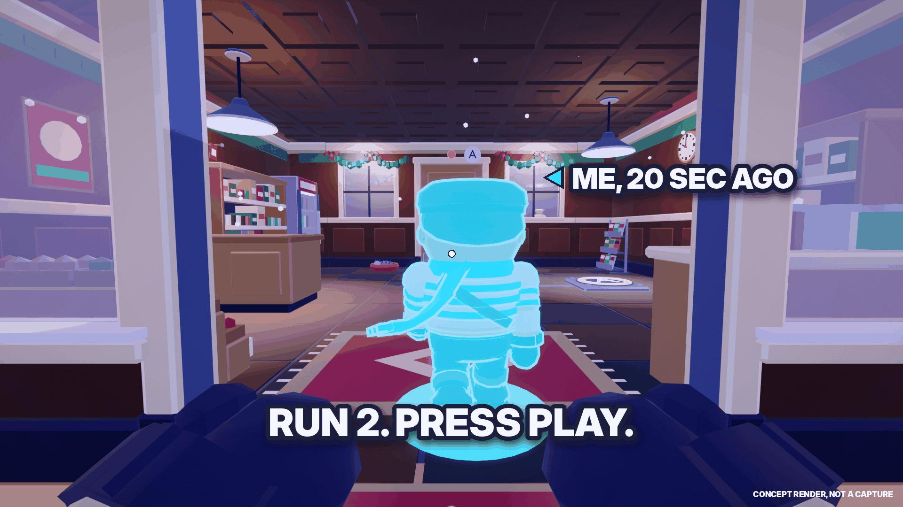
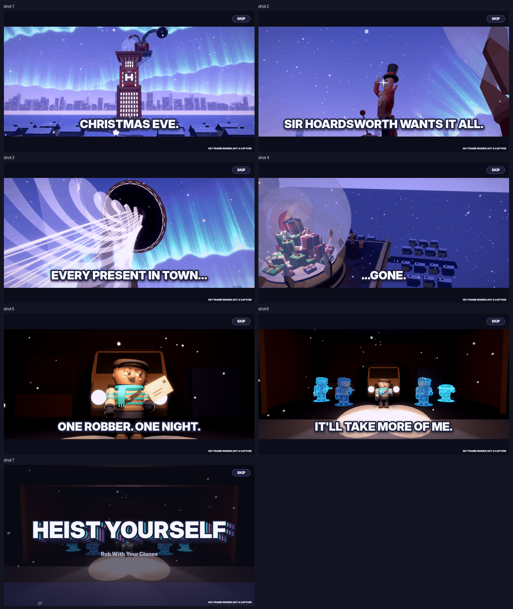
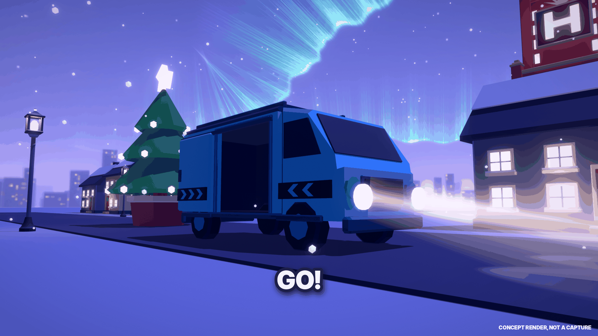
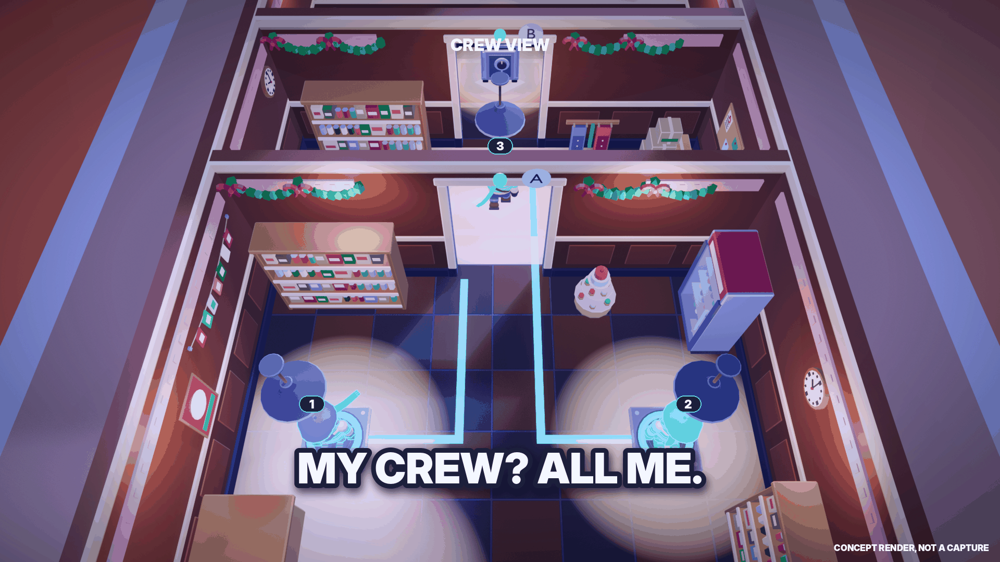
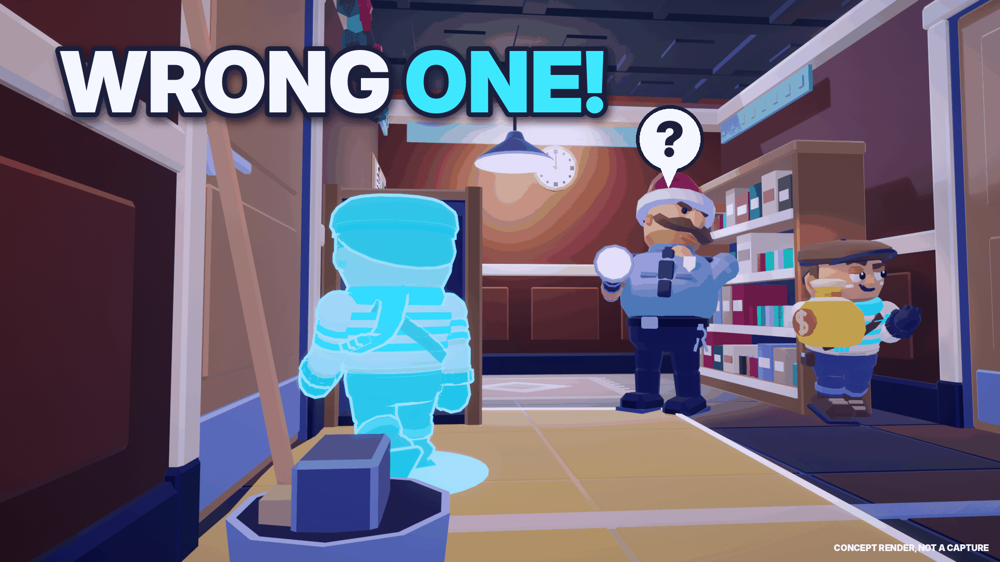
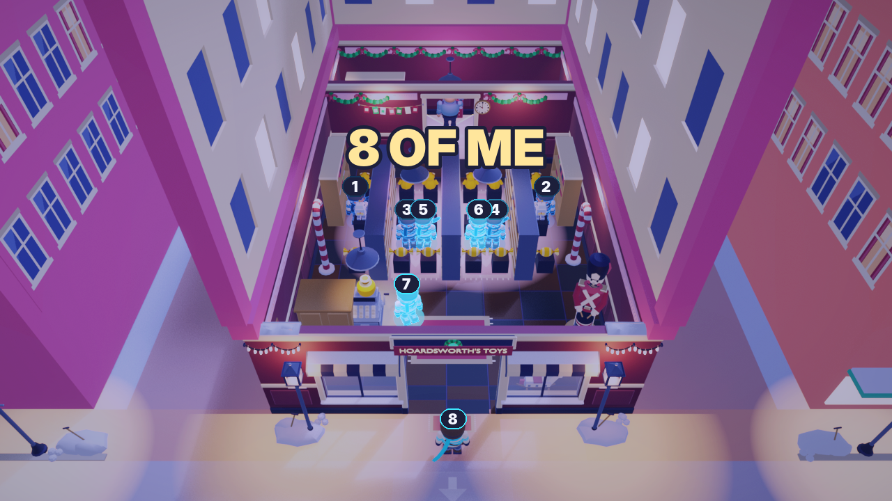
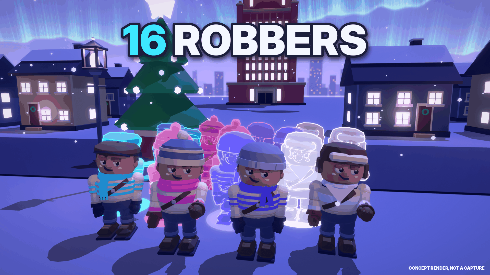
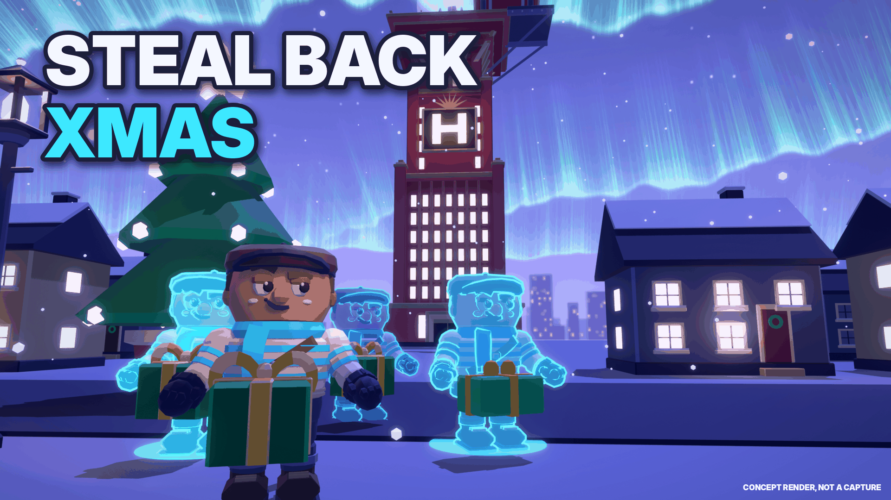
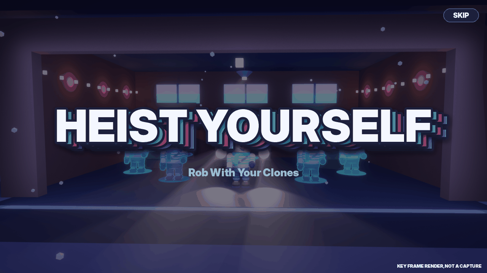

# TRAILER: the 30-second launch trailer (sound-off readable)

_Marketing kit. Written 2026-11-13 for the first-person pivot (docs/PLAN_FIRST_PERSON.md). Sources: MASTERPLAN §9.1-9.4 (one-second sell, the eight formats, the video thumbnail), docs/VIRAL_PLAYBOOK.md §1 (a one-line rule in 3 s, the visual works without voice), CLIPS.md §1 (the seven musts, the "◀ ME" caption, 9:16 safe areas), docs/art/intro/STORYBOARD.md (the intro's shots and captions), docs/GOLDEN_FRAMES.md and `src/shared/Heist/Scenario.luau` (the Studio staging, read only). Capture steps: CAPTURE.md._

**What it is for:** the launch trailer for TikTok / Shorts / Reels (9:16 cut), the devlog and creator DMs (16:9), and, cut without our caption cards, the **Roblox video thumbnail** (real gameplay, no narration, no music with lyrics, in-game text only: the intro's own captions and the game's stamps are in-game text; ICON_THUMBNAILS.md §5).

**The rules it follows:**
1. **Hook in the first second:** the first frame is a clone of you walking out of you, with `◀ ME, 20 SEC AGO` (CLIPS.md §1.2). No logo first.
2. **Sound-off readable:** every shot carries one caption of **≤ 6 words** (the intro's cards are already this), or an in-game stamp (8 OF ME, the "?" pop). Music is a bonus (MUSIC_BRIEF.md); no voice-over.
3. **≤ 30 s**, cuts every 1.2-3 s, one idea per shot. The story (intro) gets ~10 s, the mechanic ~15 s, the title ~3 s.
4. **9:16 safe:** every subject and caption sits in the **central third of the 16:9 frame** (the 9:16 crop keeps x 656-1264 of 1920), captions between 12 % and 75 % of the height (CLIPS.md §1.3).
5. **Only real footage** in the final cut. The key frames below are Blender stand-ins from the real kit (labelled "CONCEPT RENDER, NOT A CAPTURE"); the owner replaces each with the Studio capture named in the last column.

---

## 1. Shot list (29.5 s)

Time is trailer time. "Key frame" = the render that shows the intended frame. "Studio staging" = how to get the real footage (CAPTURE.md has the step-by-step): an `EH_Scenario` value (Workspace attribute, Studio only, docs/GOLDEN_FRAMES.md "Capture") or the plain level and runs.

| # | Time | Len | Beat | Picture (first person unless noted) | Caption (burned in) | Key frame | Studio staging |
|---|---|---|---|---|---|---|---|
| 1 | 0.0-2.0 | 2.0 | **HOOK: the first clone walks out of you** | Run 2 of L1 Back Room starts: your clone tape-prints out of your body (feet first, the scan band) and steps toward the shop door; your gloves low in the frame, the reticle | `◀ ME, 20 SEC AGO` on the clone (0.0-1.5 s), then `RUN 2. PRESS PLAY.` | `trailer/TR04_first-clone.png` | No scenario. L1: run 1 = walk in, GRAB the cash, back to the van, **REWIND at ~0:18**; run 2 = don't move, record 0:00-0:03 |
| 2 | 2.0-3.6 | 1.6 | Story: Christmas Eve | Crane over the toy town under the aurora, the tower and the Snow Globe | CHRISTMAS EVE. (the intro's card) | `docs/art/intro/shot_1.png` | `EH_Scenario = INTRO`, intro 0.0-4.8 s (use 2.5-4.1) |
| 3 | 3.6-5.4 | 1.8 | The villain | Sir Hoardsworth laughs, monocle glint, his ringed glove yanks the lever | MINE. ALL MINE. | `docs/art/intro/shot_3.png` | `INTRO`, 9.0-12.4 s (use 10.4-12.2: the yank) |
| 4 | 5.4-7.0 | 1.6 | The theft | Whip-pan to the giant vacuum, presents corkscrew up into it | EVERY PRESENT IN TOWN... | `docs/art/intro/shot_4.png` | `INTRO`, 12.4-17.8 s (use 13.0-14.6) |
| 5 | 7.0-8.2 | 1.2 | ...gone | Behind the full Snow Globe, the town's windows go dark | ...GONE. | `docs/art/intro/shot_5.png` | `INTRO`, 17.8-21.2 s (use 19.6-20.8) |
| 6 | 8.2-10.0 | 1.8 | The Rookie | Headlights snap on in the garage, the Rookie catches the letter, tugs his cap | ONE ROBBER. ONE NIGHT. | `docs/art/intro/shot_6.png` | `INTRO`, 21.2-27.2 s (use 24.6-26.4) |
| 7 | 10.0-11.6 | 1.6 | The twist, told | Four clones tape-print in behind him | IT'LL TAKE MORE OF ME. | `docs/art/intro/shot_7.png` | `INTRO`, 27.2-31.2 s (use 28.8-30.4) |
| 8 | 11.6-13.2 | 1.6 | Go | Your van pulls out of the hideout into the snowy town, headlights, the tower ahead (the drive) | GO! | `trailer/TR09_van-drive.png` | `EH_Scenario = G3` (hideout, at your van) → look at the cab → **SOLO · GO** → record the drive (2-3 s, don't press SKIP) |
| 9 | 13.2-15.6 | 2.4 | **Crew View reveal** | First person in L2 Two Doors, then **hold Q**: the camera lifts out of your eyes to the overhead crew shot: one clone on each plate holding a door, you heading for the safe, numbered pills, "CREW VIEW" | MY CREW? ALL ME. | `trailer/TR07_crew-view.png` | No scenario. L2 (CLIPS.md F2-A layout): run 1 stand on plate A, REWIND at 0:18; run 2 plate B, REWIND; run 3 walk to the safe and **hold Q** from 0:04 for 2 s |
| 10 | 15.6-18.6 | 3.0 | **WRONG ONE** | L4 back room: Gus freezes on your clone in his flashlight ("?"), you tiptoe past behind him with the deposit bag | WRONG ONE! | `thumbs/TH2_wrong-one.png` | No scenario. L4 Night Clerk, CLIPS.md §4.4 (format 4) runs; first person for the trailer take, the classic-camera take for the thumbnail |
| 11 | 18.6-21.6 | 3.0 | **8 OF ME** | Clone Party: the tape print, then the 8 OF ME stamp over eight Rookies (the pull-back) | (the in-game 8 OF ME stamp; no extra caption) | `docs/audit/levels/golden_fp/G2_eight_of_me.png`, `thumbs/TH1_8-of-me.png` | `EH_Scenario = G2` (7 clones from the solution, run 1 is you + 7: the stamp fires after the tape print) |
| 12 | 21.6-24.0 | 2.4 | With friends | Four friends' Rookies in four crew colours, each with three clones: the Line-up | + 3 FRIENDS = 16 ROBBERS | `thumbs/TH4_16-robbers.png` | No scenario. 4 clients in one crew (CAPTURE.md session C), Clone Party, 3 runs each, the Line-up at the end |
| 13 | 24.0-26.4 | 2.4 | The promise | You and your clones carry presents out under the aurora, the tower behind | STEAL BACK CHRISTMAS | `thumbs/TH3_steal-back-xmas.png` | Christmas level with presents (ICON_THUMBNAILS.md T5 setup: a present-loot daily vault); first person carrying + a classic-camera take |
| 14 | 26.4-29.5 | 3.1 | Title | The wordmark smash over the lit garage crew | HEIST YOURSELF · Rob With Your Clones · then `ON ROBLOX` (no date before the Nov 30 go, CLIPS.md §1.5) | `docs/art/intro/shot_8.png` | `INTRO`, 31.2-33.7 s |

**Cut variants (same footage):**
- **A (TikTok first):** as above.
- **B (Shorts):** open on shot 11 (8 OF ME) for 1.5 s, then shot 1, then the rest without shot 12.
- **C (Reels):** open on shot 10 (WRONG ONE), the rest as A.
- **Roblox video thumbnail (16:9):** shots 2-11 and 14 with **no added captions** (the intro's cards and the stamps are in-game text), no music with lyrics, ≤ 30 s. Upload rules: ICON_THUMBNAILS.md §5 (3 uploads a month, rejections included).
- **Devlog 1 (Nov 19):** shots 1 and 9-11 only, 12 s, with the devlog hook (CLIPS.md §6).

**Calls to action:** none burned into the video before stage 3 (CLIPS.md §1.5). The end card says `ON ROBLOX`, never "out now", "free" or a date before the go.

---

## 2. Storyboard

Key frames in order (Blender stand-ins from the real kit; the intro frames are the intro track's renders of the same `IntroPlan` data the game plays). New renders for this trailer: `docs/marketing/trailer/` (`python3 tools/blender/thumb_shots.py --only TR04_first-clone` etc., one per command; `--sheet` rebuilds `trailer/new_frames_sheet.png`).

| # | Frame |
|---|---|
| 1 |  |
| 2-7 |  (shots 1, 3, 4, 5, 6, 7) |
| 8 |  |
| 9 |  |
| 10 |  |
| 11 |  |
| 12 |  |
| 13 |  |
| 14 |  |

**What the renders can't show (check in the capture):** the motion (the tape print is a 0.5 s rise, Crew View is a 0.25 s ease), the HUD (loop clock, REWIND, clone strip) that the real first-person frames carry, Gus's 2.0 s freeze timing, and the drive's speed. The Crew View frame draws the pills and the label approximately; the game's own HUD is the truth.

---

## 3. Edit notes

- **Pace:** cut on action (a door, a grab, a stamp), never on a still. Shots 2-7 can use the intro's own cuts: the intro is already paced at 3-6 s a shot, so the trailer takes 1.2-1.8 s from each (the column "use").
- **Captions:** the intro's caption cards are in-game; for shots 1, 8-10, 12-13 burn the caption in the same style (heavy caps, Getaway White, Ink Indigo outline, the key word in Clone Cyan: ICON_THUMBNAILS.md §2), lower third, ≥ 54 px cap height on a 1080-wide 9:16 frame.
- **The "◀ ME" caption** follows CLIPS.md §1.2 (true number: run 1 must end at ~0:18 for "20 SEC AGO").
- **Audio:** the intro's cues and the game's stingers if licensed ids exist (docs/AUDIO.md), else a library track with no lyrics (CLIPS.md §1.6); the trailer must read with the sound off.
- **Child safety:** no usernames, chat or player lists on screen; the four friends in shot 12 need the written permission (LAUNCH_CHECKLIST appendix B); hide name pills (CAPTURE.md).
- **9:16 check:** before export, overlay the 9:16 crop on every shot; anything essential outside x 656-1264 gets reframed or re-captured (the thumbnails' contact sheet shows the same crop: `thumbs/contact_sheet.png`).

## 4. Open points

1. The drive (shot 8) is a client stage (`Heist/Drive`) that skips on any key: record with hands off the keyboard.
2. Crew View has never been seen on a device (PROJECT_STATE): if its lift or vignette reads badly in the capture, shot 9 becomes the classic camera's view of the same moment, caption unchanged.
3. Shot 13 needs a level with presents as loot at launch (the T5 capture brief's daily vault) or the Dec 11 Wrapping Room: until then use TH3 only as direction, and fill the slot with a second 8 OF ME angle.
